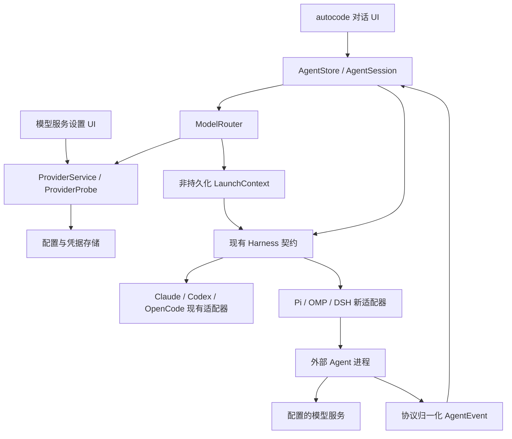
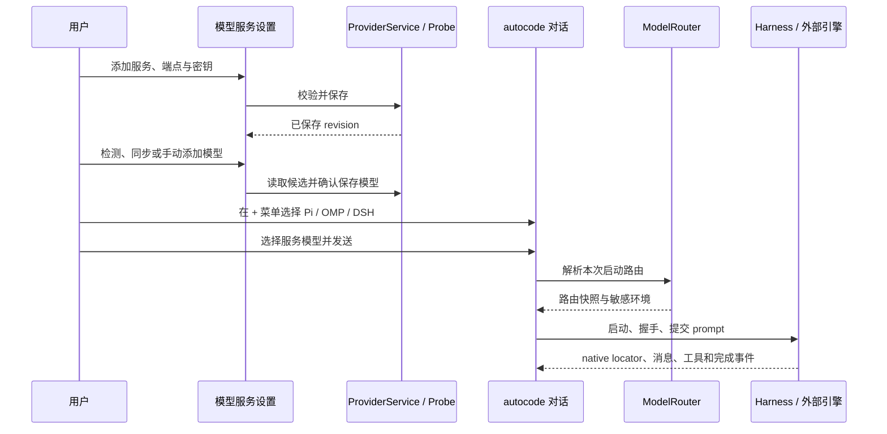

# Agent 后端与模型服务集成概要设计

## 1. 文档定位

### 1.1 目的与依据

本设计基于[Agent 后端扩展规划](agent-backend-extension-design.md)，确定 autocode 扩展 Pi、OMP、DSH 及统一模型服务的总体架构、模块职责、数据归属、运行流程和交付标准，不展开具体 RPC 帧结构、数据库 DDL 或函数实现。

本文描述**目标设计，不代表功能已实现或已完成运行验证**。规划中的协议行为参考本地 `thinkrail-native` 和 `auto-craft`；实际支持范围须在实现时针对安装的引擎版本验证。

- 改造对象：当前 `autocode/` 工程中的对话功能。
- 文档存放：`autocode/docs/`，不表示需要另建一套应用。
- 主要参考：`E:/workspace/notepad-dev/thinkrail-native`。
- 模型服务界面参考：`E:/workspace/notepad-dev/auto-craft/auto-craft`。

### 1.2 两个交付目标

1. 在当前“对话”面板的 `+` 菜单中，保留 Claude Code、Codex、OpenCode，增加 Pi、OMP、DSH，并接入现有会话体系。
2. 在设置中集成“模型服务”，实现服务配置、密钥管理、模型维护、检测与同步，最终能够驱动 Pi、OMP、DSH 的真实对话。

只有菜单入口、只有 Provider 设置界面或只有生成配置文件，均不视为交付完成。

### 1.3 范围边界

| 范围 | 决策 |
|---|---|
| 对话面板、标签页、消息流、工具卡 | 复用 autocode，不另建聊天系统 |
| Pi、OMP、DSH | 新增独立 Harness，使用外部引擎执行模型循环和工具 |
| 模型服务 | 三个新增后端共用一套服务、模型与密钥管理 |
| Claude Code、Codex、OpenCode | 保持现有启动、认证、模型目录和权限行为 |
| 原生会话 | 由引擎维护，autocode 保存定位标识和自己的展示记录 |
| ThinkRail 业务 | 不引入其计划、审查、工作流和宿主工具系统 |
| 安装管理 | 复用可执行文件发现与配置；不将完整自动安装器作为本次前提 |
| 协议转换 | 不实现任意 OpenAI/Anthropic 互转，不以换 URL 冒充协议兼容 |

## 2. 产品交互设计

### 2.1 新建对话入口

沿用现有活动栏“对话”按钮和面板顶部 `+` 按钮。菜单顺序为 Claude Code、Codex、OpenCode、Pi、OMP、DSH，分隔线之后仍为“继续已保存的对话…”。不增加第二个 Agent 面板。

- 菜单选择的是 **Agent 引擎**，不是模型服务商。
- 点击后创建对应类型的 autocode 对话，聚焦同一个输入区。
- 空白对话不必立即启动进程；首次需要模型发现或发送时后台启动。
- 未安装或版本不兼容时显示原因和配置入口，保留输入，不静默改用其他 Agent。
- Agent 显示开关沿用现有设置约定；新增三项并保持至少一个可见。
- 已有对话的后端不可原地改写；切换 Agent 通过新建对话完成。

### 2.2 模型服务设置

设置中增加“模型服务”页面：左侧服务列表，右侧服务详情与模型列表，复用 autocode 的主题和控件约定。参考项目的视图结构，不直接引入其整套 UI 框架。

| 区域 | 用户能力 |
|---|---|
| 服务列表 | 新建、选择、搜索、启用、停用、删除自建服务 |
| 服务详情 | 名称、协议线路、API 地址、自定义请求头 |
| 密钥管理 | 添加多个 Key、掩码显示、显式查看/复制、启停、删除、轮流使用 |
| 模型列表 | 同步候选、手动添加、编辑、搜索、启停、移除 |
| 模型属性 | 模型 ID、显示名、上下文窗口、最大输出、图片、工具、推理档位 |
| 检测结果 | 连接状态、HTTP 状态、耗时和安全错误分类 |

编辑后按现有交互约定保存；失败保留草稿，禁止显示为已保存。异步结果绑定服务 ID、revision 和操作代次，切换服务后不接受旧操作覆盖当前页面。切页或关闭设置时清理明文密钥。

### 2.3 后端配置与模型选择

每个新增后端区分两种配置来源，不隐式混用：

- **引擎原生配置**：使用用户已有的 Pi/OMP/DSH 配置与认证；模型目录由该引擎发现。
- **autocode 模型服务**：使用 autocode 中启用的服务、模型和明确选择的默认模型；由 autocode 生成会话级配置。

配置来源、默认服务/模型和可执行文件路径放在 Agent 设置中；具体会话保存自己的选择。新建对话可继承该后端最近一次有效选择，但不能覆盖已有聊天。

模型选择器继续位于当前聊天输入区，显示“服务名称 / 模型名称”，只列出当前 Agent 支持的候选。选择器不得跨后端切换，不得在选定模型失效时偷偷选择另一个模型。

## 3. 总体架构

### 3.1 模块职责

| 模块 | 职责 | 不负责 |
|---|---|---|
| `agent_chat` | 菜单、会话展示、输入、模型选择、设置交互与任务调度 | RPC 解析、HTTP 转发、直接读取密钥表 |
| `AgentStore` | autocode 聊天索引、活跃会话、默认选项、模型目录缓存 | 保存全局活跃子进程或可变路由上下文 |
| `AgentSession` | 一个聊天的运行状态、native locator、问题和消息投影 | 另一份 Provider 数据库 |
| `agent_harness` | 后端协议、进程生命周期、事件规范化、能力报告 | Provider 编辑和数据库 schema |
| `model_provider`（新增逻辑组件） | 服务与模型类型、配置持久化、凭据访问、探测、路由准备 | GPUI 类型和聊天消息状态 |
| 后端配置投影器 | 将已解析路由生成 Pi extension、OMP overlay、DSH patch | 选择密钥、修改用户全局配置 |

### 3.2 依赖约束

- 保留 `Harness`，不同时引入第二套 `AgentRuntime` / `SessionSnapshot` 作为聊天权威状态。
- 模型服务使用独立、UI 无关的 `model_provider` 组件；存储与 HTTP 实现可以留在该组件，不为了分层再拆多个小 crate。
- `agent_chat` 组合 `agent_harness` 和 `model_provider`；`agent_harness` 可以消费模型服务的启动投影类型，模型服务不得反向依赖 Harness。
- 路由使用自身的后端目标标识或能力输入，不直接引用 `agent_chat::AgentKind`，避免循环依赖。
- 共享组件采用 autocode 的 Rust 模块与执行器约定；参考项目的阻塞服务调用不能直接搬到 GPUI 主线程。

## 4. Agent 后端设计

### 4.1 接入方式

| 后端 | 进程协议 | 自定义服务注入 | 本轮完成依据 |
|---|---|---|---|
| Pi | `--mode rpc`，JSONL | Provider extension | `agent_settled`；本地命令处理结果另行结束 |
| OMP | `--mode rpc-ui`，协商 v2 | Provider extension + 配置 overlay | `session_settled` 或具有完成语义的 `prompt_result` |
| DSH | `--profile acp`，ACP JSON-RPC | Provider YAML patch | 对应 `session/prompt` 的回复 |

Pi/OMP 可以共享同族消息和交互解析；DSH 只共享通用进程、帧和请求关联设施。不得因为都是 JSON 就共用同一套完成状态机。

DSH 的进程 cwd 与会话工作目录分离：进程运行于其配置目录，项目目录通过 ACP 传递，避免意外读取项目 `.env`。具体参数顺序、模型 option 编码和版本差异由详细设计与真实协议验证确定。

### 4.2 能力驱动

沿用现有权限 UI，补充后端能力声明；启动握手后可以收窄实际能力。

| 能力 | Pi | OMP | DSH |
|---|---|---|---|
| 原生恢复 | 支持，空会话持久化状态须检查 | 支持 | 依据握手声明 |
| 原生历史回放 | 支持 | 分页读取 | 当前参考适配器不支持 |
| 文本流 | 增量 | v2 分片重组后的增量 | 提交块，不能承诺 token 增量 |
| 问题交互 | extension UI | extension UI / ask | 不承诺通用问答 |
| 工具审批 | 不承诺逐工具审批 | 默认询问 | 处理引擎主动发出的权限请求 |
| 会话内切模 | 支持 | 支持 | 配置 option |
| 压缩 / 原生命名 | 有对应命令 | 当前参考适配器不提供 | 当前参考适配器不提供 |
| 运行中追加指令 | 支持 steering | 支持 steering | 不提供，使用 autocode 发送队列 |

“不支持原生命名”不影响 autocode 本地修改聊天标题；“不支持原生回放”不应删除已有 autocode 展示记录。工具审批不等同于操作系统沙箱，界面不能把一种能力描述为另一种。

### 4.3 进程与会话所有权

- `AgentStore` 可以共享不可变的后端描述或 Harness 实例，但每个聊天拥有独立运行上下文和子进程资源。
- `LaunchContext` 是非持久化运行对象，携带路由、敏感环境、支持目录和启动代次；不直接序列化进现有 `RunRequest`。
- Harness 接口需要扩展启动上下文的传入方式，但不把可变 Provider/密钥挂在按 Agent 类型共享的 Harness 上。
- 停止表示取消当前轮次；关闭标签、关闭聊天和退出应用遵循 autocode 现有生命周期策略，不把停止一律等同于删除聊天或强制退出进程。
- 一次运行结束或进程退出后，清理职责仍由该聊天的运行上下文承担；支持目录不可在进程仍读取时提前删除。

## 5. 模型服务与路由设计

### 5.1 核心数据

| 对象 | 关键数据与不变量 |
|---|---|
| Provider | 稳定 ID、名称、启用状态、revision；名称改变不改变身份 |
| Endpoint | 所属服务、协议、Base URL；支持 OpenAI Chat、OpenAI Responses、Anthropic Messages |
| ProviderModel | 所属服务、模型 ID、显示名、能力、token 限制、支持协议和启用状态 |
| ProviderKey | Key ID、所属服务、标签、启用状态和凭据引用；普通查询只返回掩码 |
| ModelRef | 服务稳定 ID + 模型 ID；原生模式模型没有 autocode Provider 身份 |
| AgentPreferences | 配置来源、可执行文件配置、默认模型和默认推理档位 |
| EngineRouting | 本次启动解析出的 Provider 路由、模型信息、秘密环境和配置签名，不落入聊天元数据 |

Provider、协议线路和模型不是一一对应关系：一个服务可以提供多种协议，一个模型可以声明多条可用线路。最终路由必须是“当前后端 × 启用服务 × 启用模型 × 兼容协议”的交集。

### 5.2 统一路由

`ModelRouter` 的职责为：

1. 根据会话配置来源决定使用原生发现还是 autocode 模型服务，不静默合并两者。
2. 校验服务、模型和端点的有效性，过滤不支持的能力。
3. 选择一个启用的 Key；无认证本地服务允许无 Key，不能伪造有效凭据。
4. 规范化 API 地址并构造引擎支持的路由；不得盲目给所有地址追加 `/v1`。
5. 输出路由投影和敏感环境，生成不含秘密的配置标识。
6. 让对应 Harness 生成会话级配置并启动。

模型身份在宿主中始终结构化保存；仅在引擎边界编码为该引擎需要的字符串或 option value。DSH 的不透明模型 option 不按 UI 展示名反向推导。

### 5.3 Key 轮流使用的确定语义

Direct 模式在**每次新进程启动准备路由时**，从服务启用的 Key 中选择下一个；同一进程后续模型请求沿用所选 Key。读取模型目录、计算签名和点击检测不推进轮询。

这不是“每次 HTTP 请求切换 Key”，也不承诺失败后自动换 Key 重试。若要达到截图文案所描述的逐请求轮询，必须由透明 loopback Gateway 在请求边界选 Key，不能仅靠启动环境实现。

逐请求轮询作为模型服务的完整目标：需要该策略的服务走 Gateway；选择 Direct 的服务明确显示“按启动轮换”。Gateway 只负责鉴权、原协议转发、Header 注入和选 Key，不承担跨协议转换或无界重试。流式请求一旦发送内容，不能因失败自动重放工具或模型请求。

### 5.4 配置变更

- 运行中的进程使用启动时的配置快照；设置保存不会热改写它正在使用的文件。
- 下次启动应用最新服务配置，但保留会话自己的模型选择和后端。
- 发现配置变化时提示是否在空闲后重启当前 Agent；重启先验证可恢复性，不能静默创建一个空原生会话替代旧会话。
- 切换已有路由中的模型可以调用引擎原生命令；需要加载新增 Provider 时按安全重启流程处理。
- 服务停用或删除后，下一次启动给出明确错误，保留历史和草稿；不回退其他服务。

## 6. 关键业务流程

### 6.1 首次使用自定义服务

检测与同步必须以成功保存的 revision 为目标。`/models` 成功只说明目录请求可用，不证明模型工具调用可用；模型检测使用单独的最小推理请求，并在 UI 标注两种结果的区别。

### 6.2 发送、交互与终态

1. autocode 保存用户输入并创建启动代次，在后台检查安装、路由和协议。
2. 握手成功并拿到真实 native locator 后保存原生绑定；未持久化的空会话标为尚不可恢复。
3. 提交 prompt，消息和工具事件按稳定标识归一化到现有 `AgentEvent`。
4. 遇到问题或权限请求时显示交互；取消、过期或关闭必须回到引擎支持的取消语义。
5. 仅接受当前运行代次的消息和响应，旧进程退出后的迟到回调不能覆盖新状态。
6. 根据各后端真实完成信号结束当前轮次，处理排队消息；EOF、启动失败和异常退出分别反馈，不伪装成正常完成。

所有进程启动、探测、数据库 I/O 和阻塞 RPC 都在后台执行。协议读循环不得同步等待 UI 回答或执行耗时工具。

### 6.3 恢复与“继续已保存的对话”

autocode 自己保存的六类聊天统一按其后端与 locator 打开；“外部已保存对话发现”则按后端实际提供能力接入，不因为菜单统一而假定所有后端都有 session/list。

- Pi/OMP 可以通过原生定位标识读取历史，展示时避免与 autocode 现有记录重复插入。
- DSH 只有握手声明支持恢复时才尝试恢复；没有原生回放时仍显示 autocode 已保存的内容。
- 不支持恢复的旧聊天仍可查看；明确提供“新建 DSH 对话”，不覆盖旧绑定。
- 不改变现有聊天文件归属，不将新增支持目录混入 autocode 的聊天索引和 entries 文件。

## 7. 数据持久化与兼容

### 7.1 数据归属

| 数据 | 所有者与存放方式 |
|---|---|
| autocode 聊天元数据与展示记录 | 延续现有 `AgentStore` / `SessionMetadata` / entries 文件 |
| 引擎上下文和原生历史 | 各引擎自己的持久化机制，autocode 不改写 |
| Provider、Endpoint、模型、偏好 | 模型服务本地存储；新增表通过 schema 版本管理 |
| Key 和敏感 Header | 受保护的凭据存储；配置库只保存引用或受保护载荷，不把普通 TEXT 表当安全存储 |
| extension、overlay、patch | autocode 数据目录下独立运行支持目录，只含非敏感值和环境变量引用 |
| 活跃进程、请求关联、轮询游标 | 内存；不保存进程对象或未完成 RPC 到数据库 |

凭据存储优先复用宿主可用的系统凭据能力；不能因参考项目以 TEXT 保存 Key，就声称已经加密。具体跨平台实现由详细设计确定，无法安全读取凭据时明确失败。

### 7.2 旧数据兼容

- 保留 `claude`、`codex`、`opencode` 的已有序列化值，新增 `pi`、`omp`、`dsh`。
- 旧裸模型字符串在读取边界转换为原生模型引用；新增写入使用统一结构，不长期保留两套运行路径。
- 现有默认选项、会话条目和 entries 文件不做破坏性重建。
- 数据损坏、未知 schema 或迁移失败时保留原文件并报错，禁止自动清空配置。
- Provider 和模型目录缓存绑定配置 revision、来源与后端；设置变更后失效，不能仅以 Agent 类型永久复用旧目录。

## 8. 安全、可靠性与性能

### 8.1 安全边界

- 模型服务支持本地地址和 HTTPS 地址；无认证本地服务是合法配置，远端明文 HTTP 必须明确提示风险。
- 明文 Key 不进入聊天元数据、生成配置、命令行参数、普通日志或错误正文；UI 查看需显式操作。
- 自定义 Header 可能同样是秘密，按照凭据处理。
- 重定向不向其他源转发鉴权信息；检测不能把服务返回的任意 URL 当作新的受信任端点。
- autocode 管理模式清理冲突的供应商环境后注入本次配置；原生模式只保留显式选择的环境引用与引擎配置，不直接照搬“全部清空”而破坏原生认证。
- Windows 的 Node/Bun 启动器使用显式可执行文件与参数数组，避免拼接 shell 命令；引擎启动失败不得尝试任意替代命令。
- 进程树按所属 PID 关闭，不按名称查杀；只清理 autocode 所有的生成目录，永不递归删除用户配置目录。

### 8.2 可靠性约束

- 握手、探测、取消和关闭都有明确超时；数值由详细设计按具体协议确定。
- 帧大小、OMP 分片累计大小、历史回放和工具输出有界。
- token 增量按块追加，不在每个 delta 上复制完整聊天历史。
- 并行聊天的支持目录使用聊天 ID 与启动代次隔离，旧运行清理不能删除新运行配置。
- Provider 写入使用 revision 和原子提交；过期异步结果不得回写新草稿。
- 日志记录后端、阶段、状态与安全错误分类，不记录消息正文、完整协议帧或原始 stderr。
- 成本、token 用量和上下文信息只展示引擎报告或明确标记的估计；未知不显示为零。

## 9. 实施与验收

### 9.1 实施依赖

| 阶段 | 工作 | 出口条件 |
|---|---|---|
| A：菜单与契约 | 六类 Agent、动作、本地化、能力与会话数据兼容 | 原有聊天不回归；新增入口创建正确类型，未接入后端明确不可用 |
| B：协议闭环 | Pi、OMP、DSH 各自启动、发送、交互、取消、退出和恢复能力 | 每个后端都有真实运行证据，不以菜单完成代替协议完成 |
| C：模型服务 | Provider、凭据、偏好、探测、模型目录和路由 | 同名模型隔离、revision、无 Key 本地服务和 Key 轮询语义正确 |
| D：启动投影 | 三类后端配置生成、并发隔离、Direct 与所选轮询策略 | 三个 Agent 均能使用兼容的自定义服务完成对话 |
| E：设置联调 | 服务设置、模型选择、配置变更和错误提示 | 从 UI 配置到真实请求端到端闭环 |

阶段表示实施顺序，不是缩减最终范围。A 阶段的不可用入口只是开发中间状态，不能作为发布完成。

### 9.2 验收矩阵

| 场景 | 必须观察到的结果 |
|---|---|
| 六个菜单项 | 正确后端、同一聊天 UI、键盘导航和显示开关正常 |
| 三类真实引擎 | 文本、思考或提交块、工具事件和真实完成信号正确 |
| OMP / DSH 权限 | 允许、拒绝、取消、过期均不挂起会话 |
| 恢复与应用重启 | 原后端与 locator 不变；不支持恢复时保留展示历史并说明 |
| 三种 API 协议 | 在引擎声明兼容的组合上完成真实模型请求；不兼容组合启动前报错 |
| 多服务同名模型 | 选择、保存、恢复和切模均使用正确服务身份 |
| 自定义 Header / 多 Key | 上游实际收到预期配置；按启动与逐请求轮询分别验收 |
| 保存、同步和检测失败 | 草稿不丢失，不发送依赖失败保存的请求，不污染别的服务 |
| 并行聊天 / 重启进程 | 环境、生成文件和清理动作互不干扰 |
| 凭据安全 | 日志、生成文件、聊天元数据与命令行均无明文 Key |
| 原有三类 Agent | 原有登录、发送、停止、模型发现和恢复行为保持 |

验证分层：协议与路由的确定性测试、隔离配置下的真实 CLI 场景、实际 GPUI 页面交互。编译通过只能证明类型检查，不能替代运行与视觉验证。

## 10. 详细设计交接

后续详细设计需落实以下接口，不改变本概要中的职责边界：

1. `Harness` 启动上下文、能力协商、生命周期与 `AgentEvent` 映射。
2. `ModelRef` 和旧模型字符串的一次性读取兼容。
3. Provider schema、凭据后端、revision 更新与缓存失效。
4. 路由快照、配置来源、Key 轮询与透明 Gateway 请求边界。
5. Pi、OMP、DSH 各自的版本基线、参数校验和失败清理。
6. 服务设置表单、模型选择器和迟到异步响应防护。

实施参考位置：autocode 的 `crates/agent_chat/src/agent_panel.rs`、`session.rs` 与 `crates/agent_harness/src/agent_harness.rs`；协议与投影参考 ThinkRail 的 `crates/agents/src/`，模型服务参考其 `crates/routing/` 和 `crates/settings-store/`。

与原规划相比，本文明确了容易误解的边界：Direct 注入不等于逐请求轮询；统一菜单不等于统一所有能力；native history 与 autocode 展示记录不是同一份数据；模型服务秘密不应直接进入可序列化 `RunRequest`。这些约束应进入后续详细设计和验收，而不是在实现中静默忽略。
