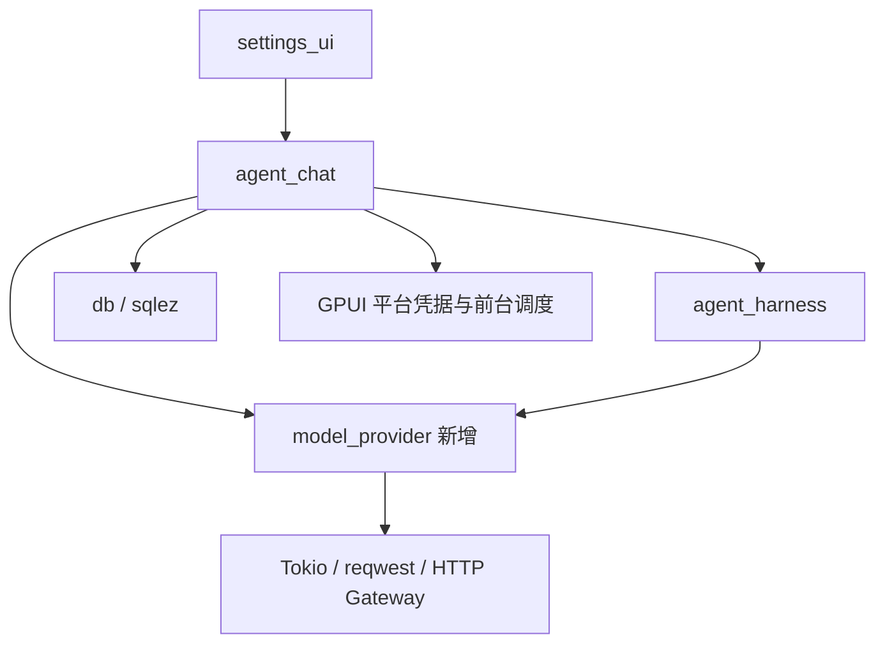
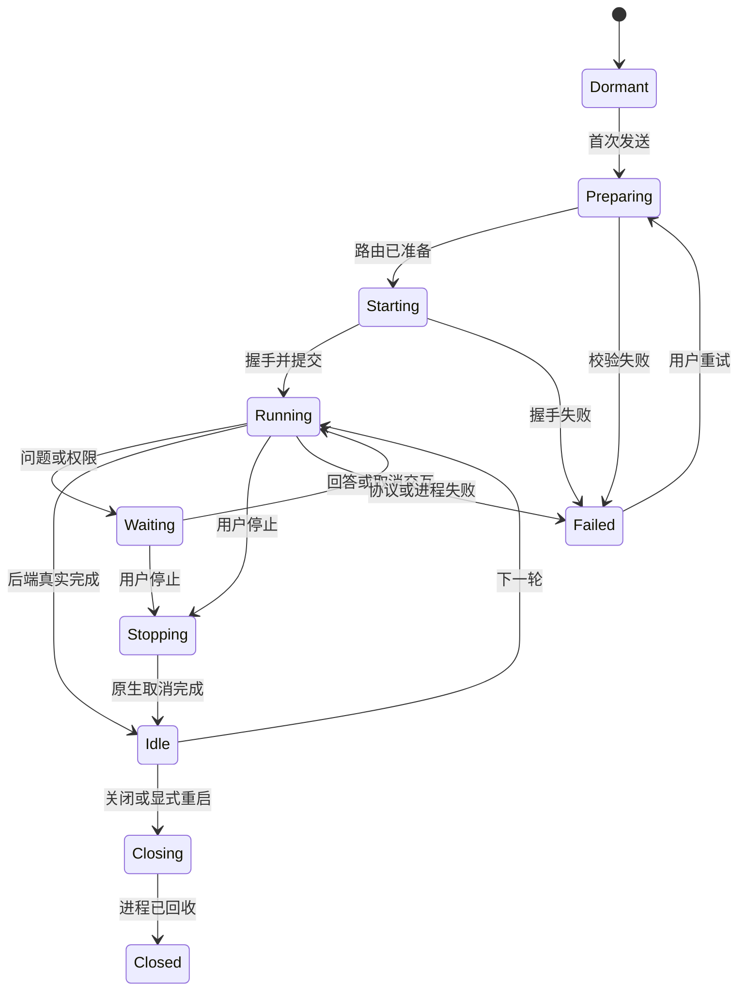

# Agent 后端与模型服务集成详细设计

## 1. 实施合同与阅读顺序

### 1.1 文档状态

本文是交给编码大模型实施的目标合同，不是实现完成报告。上位依据为[02-概要设计](02-概要设计.md)，需求背景见[扩展规划](agent-backend-extension-design.md)。本文细化概要中未确定的接口和默认值；若实际协议与本文不符，实施者必须记录证据并修正对应设计，不能通过吞错误、伪造响应或静默回退绕过。

工作目录约定：

- **代码根目录**：`E:/workspace/autocode-dev/autocode`。
- **文档目录**：`E:/workspace/autocode-dev/autocode/docs`。
- 本文所有 `crates/`、`assets/`、`script/` 路径默认相对代码根目录。
- `model_provider`、`provider_store.rs` 等标注为“新增”的内容是目标文件，不是当前已有实现。
- 修改源码前读取 `autocode/AGENTS.md`、当前文件及受影响调用者；不修改原工程业务边界以迎合参考项目。

实施范围必须同时包含：六后端菜单、Pi/OMP/DSH 真实协议接入、统一模型服务设置、三种 API 协议、Direct 按启动轮换、Gateway 逐请求轮询、凭据保护、配置投影、旧会话兼容、端到端验证。

### 1.2 已核对的实现基线

| 现有位置 | 核对结果与实施含义 |
|---|---|
| `agent_chat/src/agent_chat.rs` | `AgentKind` 当前三项，动作集中定义；扩展到六项 |
| `agent_chat/src/agent_panel.rs` | `init` 注册新建动作，`new_chat_action` 映射，`create_session` 处理本地项目限制 |
| `agent_chat/src/session.rs` | `AgentStore` 缓存 Harness，`start_run` 建立控制通道，`deliver` 在进程存活时通过 steering 通道继续发送 |
| `agent_harness/src/agent_harness.rs` | `Harness::run` 返回 `AgentEvent` 流；`RunControls` 已有问题、steering、取消和权限通道 |
| `agent_harness/src/proto.rs` | `RunRequest.model` 当前为裸字符串；`AgentEvent::Done` 与流 EOF 是两个不同概念 |
| `settings_content/src/settings_content.rs` | `AgentChatAgent`、显示开关、默认权限的真实定义位置，不在 `settings/src` |
| `settings_ui/src/settings_ui.rs` | `SubPageLink.render` 可嵌入自定义页面；`DynamicItem` 只是判别式设置组，不是任意动态视图注册器 |
| `db/src/db.rs` | 已有共享 `AppDatabase`、Domain 迁移和 `static_connection!`，不引入第二套 Turso 数据库 |
| `gpui/src/app.rs` | 已有 `write_credentials/read_credentials/delete_credentials` 异步平台任务 |
| `gpui_windows/src/platform.rs` | 使用 Windows Credential Manager；写入受平台 blob 大小限制，错误不能转成成功 |
| `gpui/src/platform/test/platform.rs` | 默认测试凭据写入为 no-op、读取为 None；不能用该默认行为证明凭据已保存 |

本次文档核对时没有配置可用的 LSP。实施环境若有语言服务，导出接口变更须先查询 references；若无服务，再以编译错误和定向搜索收齐调用点。

### 1.3 参考版本，不等于当前运行验证

`thinkrail-native/crates/agents/src/install.rs` 固定的参考包：

| 后端 | 参考包 / 版本 | 接口基线 |
|---|---|---|
| Pi | `@earendil-works/pi-coding-agent` / `1.4.0` | JSONL RPC、`agent_settled`、extension Provider |
| OMP | `@oh-my-pi/pi-coding-agent` / `18.14.2` | rpc-ui protocol v2、chunk、ask |
| DSH | `@deepseek-ai/dsh` / `0.2.1-rc.5` | ACP protocol 1、`--profile acp`、Provider patch |

不要将同名 `pi` 二进制假定为该包。实现时记录解析到的程序、包身份、版本和握手能力，使用隔离配置核验 `--help`、启动握手、模型目录、一次真实轮次。语义版本只用于诊断，协议能力才是启用条件；不编造最低版本范围。

## 2. 模块与文件落点

### 2.1 依赖方向



`settings_ui -> agent_chat` 用于嵌入导出的服务设置视图；当前 `agent_chat` 不依赖 `settings_ui`，不得引入反向依赖。`model_provider` 不依赖 GPUI、`db` 或 `agent_harness`，通过存储和凭据接口注入；避免概述中的“UI 无关组件”变成依赖 GPUI 的全局服务。

### 2.2 新增文件

| 路径 | 责任 |
|---|---|
| `crates/model_provider/Cargo.toml` | 新 crate，`[lib] path = "src/model_provider.rs"`，加入 workspace |
| `model_provider/src/model_provider.rs` | 小型公共边界、错误类型、服务组合 |
| `model_provider/src/types.rs` | Provider、ModelSelection、偏好、投影 DTO |
| `model_provider/src/service.rs` | CRUD、revision、凭据与数据库一致性编排 |
| `model_provider/src/router.rs` | 选择线路、快照、目录、按启动选 Key |
| `model_provider/src/probe.rs` | 模型发现与最小推理检测 |
| `model_provider/src/gateway.rs` | 监听器、租约、路由认证、逐请求选 Key |
| `model_provider/src/gateway/forward.rs` | HTTP 原协议转发与有界背压 |
| `model_provider/src/url.rs` | 规范化、路径拼接、来源校验 |
| `agent_harness/src/pi.rs`、`omp.rs`、`dsh.rs` | 三个 Harness 实现 |
| `agent_harness/src/agent_rpc.rs` | 新后端的请求关联、生命周期、串行写入 |
| `agent_harness/src/framing.rs` | 有界 JSONL、OMP v2 重组 |
| `agent_harness/src/pi_family.rs` | Pi/OMP 消息及 extension UI 映射 |
| `agent_harness/src/provider_projection.rs` | extension/overlay/patch 生成，不访问存储 |
| `agent_chat/src/provider_store.rs` | `ProviderDb` Domain 与 `ProviderRepository` 实现 |
| `agent_chat/src/provider_services.rs` | 每 App 组合根、GPUI 凭据 broker、Provider 事件 |
| `agent_chat/src/provider_settings.rs` | 模型服务视图、草稿和后台动作 |
| `agent_chat/src/provider_settings/forms.rs` | 服务/线路/模型编辑和验证反馈 |
| `agent_chat/src/session_launch.rs` | 会话启动、generation、租约、凭据准备 |

这是责任划分，不要求每个 helper 单独成文件。不创建 `mod.rs`，遵守 autocode 模块约定。仅从参考项目迁移必要协议逻辑，不复制 workflow、review、host_tools、安装下载器或整套 SessionSnapshot。

### 2.3 必须修改的现有位置

- `Cargo.toml`：workspace member/dependency，复用 `reqwest`、`tokio`、`rand`、`zeroize`、`serde_yaml_ng`。
- `agent_harness/Cargo.toml`、`agent_chat/Cargo.toml`、`settings_ui/Cargo.toml`：新增必要依赖。
- `agent_chat/src/agent_chat.rs`：三种 action、AgentKind、公开设置视图与服务初始化。
- `agent_chat/src/agent_panel.rs`：动作注册、菜单、图标、标签与状态。
- `agent_chat/src/session.rs`：RunSettings、启动上下文、generation、模型切换、缓存失效、恢复。
- `agent_chat/src/model_picker.rs`：结构化模型身份与来源切换。
- `agent_chat/src/chat_view/completion.rs`：`/new` 使用 `new_chat_action(kind)`，不要再手写另一份六分支映射。
- `agent_chat/src/chat_view/composer.rs`：能力驱动的权限、附件和问题控件。
- `agent_chat/src/saved_chats.rs`：autocode 已保存聊天与外部历史区分。
- `agent_chat/src/commit_message.rs`：Harness 签名迁移，显式新后端使用同一安全启动准备流程。
- `agent_harness/src/agent_harness.rs`、`proto.rs`：启动上下文、能力、事件和命令。
- 三个现有 Harness 及测试：签名一次迁移完，不留下旧方法别名。
- `settings_content/src/settings_content.rs`、`assets/settings/default.json`：显示、权限、Agent 枚举。
- `settings_ui/src/settings_ui.rs`、`page_data.rs`：模型服务子页及 Agent 启动配置子页。
- `assets/locales/zh-CN/actions/agent_chat.json`、相关 strings/schema：动作和字段翻译。

改造维持本地项目限制；远程执行不属于本任务。

## 3. 核心类型与序列化

### 3.1 后端身份与配置来源

`AgentKind` 保留现有 `claude/codex/opencode`，新增 `pi/omp/dsh`。`HarnessId` 同步新增，原有 kebab-case 值不变。

`model_provider::BackendTarget` 只包含 `Pi/Omp/Dsh`；在 `agent_chat` 显式映射，服务层不引用 UI 的 AgentKind。

```rust
#[serde(tag = "source", rename_all = "snake_case")]
pub enum ModelSelection {
    Native { id: String },
    Managed { provider_id: String, model_id: String },
}

#[serde(rename_all = "snake_case")]
pub enum ConfigSource { Native, Managed }

#[serde(rename_all = "snake_case")]
pub enum RoutingMode { Direct, Gateway }

#[serde(rename_all = "snake_case")]
pub enum AuthMode { None, ApiKey }
```

规范：

- `Native.id` 是引擎原样提供的不透明标识；DSH 可保存其原始 option value。
- `Managed.provider_id` 是完整 UUID，不是显示名或 route 名。
- `None` 表示“未选择模型”，不表示失效模型自动回退。
- Managed 模式首次发送必须有明确模型；Native 模式允许由引擎报告默认模型。
- 同一个后端的配置来源保存在新聊天默认偏好，并复制到聊天；改全局默认不修改已有聊天。
- 模型选项、上下文窗口不使用全局固定 GPT 数值；无目录元数据时保留未知。

### 3.2 RunSettings 与兼容读取

目标内存结构：

```rust
pub struct RunSettings {
    pub model: Option<ModelSelection>,
    pub config_source: ConfigSource,
    pub reasoning: Option<ReasoningLevel>,
    pub options: serde_json::Map<String, serde_json::Value>,
    pub permission: PermissionMode,
}
```

只在持久化读取边界接受旧格式：字符串 `"gpt-x"` 转为 `Native { id: "gpt-x" }`；对象按新 tagged enum 读取；未知或损坏对象报错，不能转空。缺少 `config_source` 默认 Native。新增保存一律写新结构，旧变体只用于反序列化，不保留第二套运行接口。

扩展 `ReasoningLevel` 增加 `Off`，同步通用视图、settings 下拉、全部 catalog match；旧序列化值不变。新增后端只接受 `off/minimal/low/medium/high/xhigh/max` 中它实际支持的值。`Ultra/Ultracode/Ultrathink` 保留给现有后端，不能悄悄映射给新引擎。

Wire 层 `RunRequest.model: Option<String>` 保持作为引擎边界模型参数；结构化 Managed 身份进入 `LaunchContext.routing`，不要让 UI 直接把 `provider/model` 字符串切开。这样既不把密钥写进 RunRequest，也减少对旧 Harness 的语义改动。

### 3.3 Provider DTO

以下字段名为目标合同，省略 derive 不代表可缺失序列化测试：

```rust
pub enum Protocol { OpenaiChat, OpenaiResponses, AnthropicMessages }

pub struct ProviderInput {
    pub name: String,
    pub enabled: bool,
    pub routing_mode: RoutingMode,
    pub auth_mode: AuthMode,
    pub default_protocol: Protocol,
    pub endpoints: Vec<EndpointInput>,
    pub models: Vec<ProviderModel>,
}

pub struct EndpointInput {
    pub protocol: Protocol,
    pub base_url: String,
}

pub struct ProviderModel {
    pub model_id: String,
    pub name: String,
    pub protocols: Vec<Protocol>,
    pub context_window: Option<u32>,
    pub max_tokens: Option<u32>,
    pub vision: bool,
    pub tools: bool,
    pub reasoning: bool,
    pub efforts: Vec<ProviderEffort>,
    pub enabled: bool,
}

pub struct ProviderSnapshot {
    pub id: String,
    pub revision: u64,
    pub input: ProviderInput,
    pub keys: Vec<KeySummary>,
    pub headers: Vec<HeaderSummary>,
}
```

`ProviderEffort` 属于 `model_provider`，不依赖 Harness；在边界显式映射。`HeaderSummary` 只含 ID、名称、掩码、enabled 和 revision，不含明文值。`ProviderInput` 不含 Key 或 Header 明文。

`Secret` 使用 `zeroize::Zeroizing<String>` 持有，无 Serialize、Display；手写 Debug 固定为 `[REDACTED]`。无需承诺操作系统及外部运行时的所有内存都能清零。

### 3.4 验证规则

| 数据 | 规则 |
|---|---|
| ID | UUID，宿主生成，不截断作持久身份 |
| 名称 | trim 后 1–128 字符，服务名大小写折叠后唯一 |
| 模型 ID | 1–256 字符；拒绝控制符；允许 `/`，禁止靠斜线解析宿主身份 |
| Endpoint | `http/https`，有 host；无 userinfo/query/fragment；单协议一个端点 |
| 模型协议 | 非空、去重，每项都有对应 Endpoint；顺序决定首选协议 |
| token 限制 | 有值时为正整数且 max_tokens 不超过 context_window；不猜测未知值 |
| reasoning | false 时 efforts 必须为空；未知推理能力不自动打开 |
| Header 名 | 合法 HTTP token，大小写不敏感唯一 |
| Header 值 / Key | 不含 CR/LF/NUL，不允许命令替换；单项 UTF-8 最多 2048 字节 |
| 保留 Header | 禁止用户覆盖 host、content-length、connection、transfer-encoding、authorization、x-api-key、proxy-*、upgrade |
| 删除线路 | 被模型引用时要求在同一事务显式更新模型或拒绝，不生成悬空关系 |
| 无认证 | AuthMode::None 不要求 Key；ApiKey 模式没有启用 Key 时不能发送 |

远端 HTTP 保存时展示明文传输警告并要求显式确认；loopback HTTP 不警告。服务地址是用户主动配置的受信任边界，不扫描内网、也不自动跟随模型列表里的 URL。

## 4. 服务接口与执行器

### 4.1 三个注入边界

`model_provider` 使用 async 接口（可以沿用 `async-trait`）：

```rust
pub trait ProviderRepository: Send + Sync {
    async fn list(&self) -> Result<Vec<ProviderSnapshot>>;
    async fn get(&self, id: &str) -> Result<ProviderSnapshot>;
    async fn create(&self, input: ProviderInput) -> Result<ProviderSnapshot>;
    async fn update(&self, id: &str, expect: u64, input: ProviderInput)
        -> Result<ProviderSnapshot>;
    async fn delete(&self, id: &str, expect: u64) -> Result<()>;
    async fn begin_credential_put(&self, reference: &str) -> Result<()>;
    async fn commit_secret(&self, id: &str, expect: u64, change: SecretMetadataChange)
        -> Result<ProviderSnapshot>;
    async fn remove_secret(&self, id: &str, expect: u64, slot: SecretSlot)
        -> Result<ProviderSnapshot>;
    async fn set_key_enabled(&self, id: &str, expect: u64, key_id: &str, enabled: bool)
        -> Result<ProviderSnapshot>;
    async fn pending_credential_ops(&self) -> Result<Vec<CredentialOperation>>;
    async fn finish_credential_cleanup(&self, reference: &str) -> Result<()>;
    async fn load_preferences(&self, target: BackendTarget) -> Result<AgentPreferences>;
    async fn save_preferences(&self, target: BackendTarget, expect: u64, value: AgentPreferences)
        -> Result<AgentPreferences>;
}

pub trait CredentialStore: Send + Sync {
    async fn put(&self, reference: &str, value: Secret) -> Result<()>;
    async fn get(&self, reference: &str) -> Result<Option<Secret>>;
    async fn delete(&self, reference: &str) -> Result<()>;
}
```

`SecretSlot` 是 `Key { key_id }` 或 `Header { header_id }`。`SecretMetadataChange` 包含 slot、new_reference、masked、label/name、enabled，不含秘密。新增 slot 的 ID 由 service 预先生成；已有 slot 替换时由 repository 验证归属。`commit_secret` 必须原子完成 revision 检查、slot 插入/替换、pending_put 移除与旧引用 pending_delete；`remove_secret` 原子移除 slot 并登记 pending_delete。`delete(provider)` 同样在级联删除前登记全部引用，不能让 service 在事务外先读后删丢失并发变更。

`ProviderService` 是组合对象，持有上述两个 trait 对象，提供 create/update/delete、add/replace/remove_key、set/remove_header、reveal、catalog 等操作。`ProviderProbe`、`ModelRouter` 和 Gateway 使用已授权解析的快照，不在网络循环中调用 GPUI。

`AgentPreferences` 固定为 version、revision、target、config_source、launch、default_model、reasoning；load 缺行时产生 version=1/revision=0 的 Native 默认值，save expect=0 只允许创建，后续按 revision 更新。ProviderEnabled、KeyChanged、ModelChanged、PreferencesChanged 在事务成功后发出 `ProviderChange { provider_id?, target?, revision }`，仅用于缓存失效和 UI 刷新，不携带秘密。

公开 `ProviderService` 命令统一带目标 ID 与 expect revision，除显式 reveal 外只返回脱敏快照；`ProviderProbe::list_models/check_model` 接受已解析快照、指定协议与 Key ID；`ModelRouter::plan/prepare` 返回 §7 的启动对象。检测和路由所需的凭据读取通过 service 内部授权路径完成，不把 reveal API 当成网络层的通用快捷入口。

### 4.2 GPUI 凭据 broker

在 `agent_chat/src/provider_services.rs` 实现，不给 UI 无关 crate 加 GPUI 依赖：

1. App 初始化创建一个有界请求通道（容量 64）与服务实例。
2. CredentialStore 实现将 Put/Get/Delete 请求和 oneshot sender 投递到通道。
3. GPUI 前台任务取请求，在 `cx.update` 中创建 `App::read_credentials` 等平台 Task，然后异步 await，不在锁内或 UI 回调中 block_on。
4. 结果经 oneshot 回到 Tokio 调用者；App 关闭时所有待处理请求返回 `CREDENTIAL_UNAVAILABLE`。
5. Broker 不缓存明文、不记录引用之外的数据；平台错误映射为安全分类。

Windows 平台当前实现自身在 foreground task 内调用系统 API，本次不改其全平台实现。不得宣称“所有系统凭据调用均在后台线程”；本功能保证不额外做同步等待、不在网络转发中调用该接口。

测试用独立内存 CredentialStore，覆盖读回、失败和删除；GPUI 自带 test no-op 不是凭据验收证据。

### 4.3 App 组合根

`ProviderServices` 作为每个 GPUI App 的 Global，持有 repository、credential broker、service、router、gateway 和变更广播，不使用 process static 单例跨测试共享数据。

`agent_chat::init` 注册服务所需前台任务，第一次访问时建立 `ProviderDb::global(cx)`。设置页面与聊天都通过同一个 `provider_services(cx)` 获取服务。后台 Future 只带 Arc 和通道，不带 `&App`。

数据库读写通过现有 sqlez 队列；reqwest、Gateway、引擎 I/O 使用现有 `gpui_tokio` runtime，不创建一套阻塞 runtime 并在 UI 上 block_on。

## 5. 数据库与凭据一致性

### 5.1 复用数据库

在 `agent_chat/src/provider_store.rs` 定义 `ProviderDb`，实现 Domain，使用 `db::static_connection!(ProviderDb, [])`。复用共享 AppDatabase，不引入 Turso、不另外创建 providers.db。迁移脚本只追加，不修改已经发布的迁移。

第一版目标 schema（SQL 中 revision/sort/check 约束均需落实）：

```sql
CREATE TABLE model_providers (
    id TEXT PRIMARY KEY,
    name TEXT NOT NULL,
    name_key TEXT NOT NULL UNIQUE,
    enabled INTEGER NOT NULL CHECK(enabled IN (0, 1)),
    routing_mode TEXT NOT NULL CHECK(routing_mode IN ('direct', 'gateway')),
    auth_mode TEXT NOT NULL CHECK(auth_mode IN ('none', 'api_key')),
    default_protocol TEXT NOT NULL,
    revision INTEGER NOT NULL CHECK(revision > 0),
    sort INTEGER NOT NULL,
    created_at INTEGER NOT NULL,
    updated_at INTEGER NOT NULL
) STRICT;

CREATE TABLE model_provider_endpoints (
    provider_id TEXT NOT NULL REFERENCES model_providers(id) ON DELETE CASCADE,
    protocol TEXT NOT NULL,
    base_url TEXT NOT NULL,
    PRIMARY KEY(provider_id, protocol)
) STRICT;

CREATE TABLE model_provider_models (
    provider_id TEXT NOT NULL REFERENCES model_providers(id) ON DELETE CASCADE,
    model_id TEXT NOT NULL,
    definition TEXT NOT NULL,
    sort INTEGER NOT NULL,
    PRIMARY KEY(provider_id, model_id)
) STRICT;

CREATE TABLE model_provider_keys (
    id TEXT PRIMARY KEY,
    provider_id TEXT NOT NULL REFERENCES model_providers(id) ON DELETE CASCADE,
    label TEXT,
    masked TEXT NOT NULL,
    credential_ref TEXT NOT NULL UNIQUE,
    enabled INTEGER NOT NULL CHECK(enabled IN (0, 1)),
    sort INTEGER NOT NULL
) STRICT;

CREATE TABLE model_provider_headers (
    id TEXT PRIMARY KEY,
    provider_id TEXT NOT NULL REFERENCES model_providers(id) ON DELETE CASCADE,
    name TEXT NOT NULL,
    name_key TEXT NOT NULL,
    masked TEXT NOT NULL,
    credential_ref TEXT NOT NULL UNIQUE,
    enabled INTEGER NOT NULL CHECK(enabled IN (0, 1)),
    UNIQUE(provider_id, name_key)
) STRICT;

CREATE TABLE agent_launch_preferences (
    backend TEXT PRIMARY KEY CHECK(backend IN ('pi', 'omp', 'dsh')),
    definition TEXT NOT NULL,
    revision INTEGER NOT NULL CHECK(revision > 0)
) STRICT;

CREATE TABLE model_credential_ops (
    credential_ref TEXT PRIMARY KEY,
    state TEXT NOT NULL CHECK(state IN ('pending_put', 'pending_delete')),
    created_at INTEGER NOT NULL
) STRICT;
```

`definition` 是不含秘密的版本化 JSON：模型为 ProviderModel，偏好含 version=1、来源、默认模型、启动规格和环境引用名。模型协议关系通过验证后的 JSON 和事务保持，不重复建立第二套可变模型缓存。

### 5.2 revision 事务

更新开头执行 `UPDATE ... SET revision=revision+1 WHERE id=? AND revision=?` 并检查影响行数。0 行区分 NotFound 与 Conflict。模型、Endpoint、Key/Header 元数据和 Provider revision 在同一个写事务提交；失败全部回滚。

列表按 sort、ID 稳定排序。删除后保留聊天 ModelSelection 以便显示“服务已删除”，不把历史聊天自动改成其他模型。默认偏好若指向被删服务，置空并提示重新选择。

### 5.3 系统凭据和 SQL 无分布式事务

凭据引用格式：`autocode-model-provider://credential/<uuid>`，每个 Key/Header 值单独一条，不把所有 Header 合并成一个超过平台上限的 blob。

新增或替换秘密的流程：

1. 校验草稿，读取目标 revision；生成新的 credential_ref，不覆盖原引用。
2. SQL 写入 `pending_put` 日志，不写秘密。
3. `CredentialStore.put(new_ref, secret)`，再读取比对，确认平台真实保存；不相等则失败并清理。
4. SQL 事务重新检查 revision、修改元数据指向新引用、提升 revision、移除 pending_put；旧引用加入 pending_delete。
5. 提交后后台删除旧引用，成功移除 pending_delete；删除失败保留日志重试，UI 提示配置已保存但清理失败。
6. 步骤 3/4 失败时保留用户草稿，清理新引用；不能先删旧 Key。

删除 Key/Header/Provider：在事务中移除可用元数据并加入 pending_delete，提交后删除平台凭据。对运行中快照不立即改写（见 §7.4），下次启动不可再读取已删除的服务。

启动恢复 `model_credential_ops`：只清理没有被任何 Key/Header 元数据引用的凭据；仍被引用的条目不能删除。崩溃恢复与清理幂等。无法访问系统凭据时不回退明文数据库。

## 6. Harness 接口改造

### 6.1 启动上下文

```rust
// 仅内存，不实现 Serialize；Debug 不展开 env 或路由秘密。
pub struct LaunchContext {
    pub chat_id: String,
    pub generation: u64,
    pub launch: Option<LaunchSpec>,
    pub routing: Option<PreparedRouting>,
    pub support: Option<RunSupportLease>,
    environment: Vec<(String, Secret)>,
}

pub struct LaunchSpec {
    pub executable: PathBuf,
    pub prefix_args: Vec<String>,
    pub config_dir: Option<PathBuf>,
    pub env_refs: Vec<String>,
}

pub struct CatalogContext {
    pub launch: Option<LaunchSpec>,
    pub source_revision: String,
}
```

`env_refs` 只保存名称；后台启动前由 App 组合层从应用启动时已载入的环境中解析，值放入 LaunchContext 的私有 `environment: Vec<(String, Secret)>`。不得在任意 Tokio 工作线程内再次读取可能变化的全局环境，也不得把值保存回 LaunchSpec。对必要 PATH/SystemRoot/TEMP 等非敏感 runtime 环境单独保留。

`PreparedRouting` 在 `model_provider` 中定义，拥有非敏感 Provider 投影、`Secret` 环境值和可选 GatewayLease；不 Clone 全量秘密，移动到该聊天的 driver。`RunSupportLease` 位于 Harness；目录为 `<paths::data_dir()>/agent_support/<chat-id>/<generation>-<uuid>/`。不将这些文件混入现有 `agent_sessions/*.entries.json`。

`launch=None/routing=None/support=None` 是现有三个后端的合法原有启动语义，不是新后端启动失败的回退方案。

### 6.2 方法签名

目标一次改造：

```rust
async fn run(
    &self,
    request: RunRequest,
    controls: RunControls,
    launch: LaunchContext,
) -> Result<BoxStream<'static, Result<AgentEvent, HarnessError>>, HarnessError>;

async fn models(&self, context: CatalogContext) -> Result<Vec<Model>, HarnessError>;
```

model_catalog、model_context、commands、skills、external_sessions、external_history 在需要启动引擎时也显式传同类非敏感查询上下文；不能从 process-wide 环境悄悄读取另一个聊天配置。原有后端的模型上下文缓存保持原算法，新后端增加来源/可执行文件/配置签名。

所有直接调用者同时迁移：AgentSession、AgentStore 的目录/历史查询、commit_message、Harness 集成测试与 fake Harness。不保留 `run_old`、代理 alias 或默认返回空目录来规避编译。

### 6.3 活跃会话命令

保留现有 steering 通道用于 prompt 和运行中追加；**空闲时通过该通道提交下一轮不等于支持运行中 steering**。DSH 空闲仍可以复用进程，运行时则走 autocode 队列。

新增有界 `commands` 通道（容量 16），放入 RunControls：

```rust
pub enum SessionCommand {
    SetModel {
        selection: ModelSelection,
        reasoning: Option<ReasoningLevel>,
        reply: oneshot::Sender<Result<AppliedModel, HarnessError>>,
    },
    Compact {
        instructions: Option<String>,
        reply: oneshot::Sender<Result<(), HarnessError>>,
    },
}
```

只对新后端使用这些命令，旧后端保留现有“设置变更后下轮重启”的行为。SetModel 只有空闲且目标属于已加载路由时可执行，否则返回 Busy 或 RequiresRestart。成功后读引擎状态并返回实际模型/档位，再由 UI 保存，不采用乐观成功。

Compact 仅 Pi 开放；它本身可能使用模型且耗时，不使用普通 10 秒命令期限。autocode 本地标题改名不需要调用后端。

### 6.4 能力与新增事件

在 proto 定义 `HarnessCapabilities`：resume、history_replay、streaming_kind、questions、tool_permissions、model_switch、compact、steer、images、native_fork、drop_prompt。默认值不能把新后端假设为全支持。

新增事件：

- `CapabilitiesReported { capabilities }`：握手实际能力，不改变后端身份。
- `ModelReported { selection, reasoning }`：显式切模或引擎发起变更，经过路由反查校验。
- `SessionPersistenceReported { resumable }`：Pi 空会话文件还未持久化与真实可恢复状态区分。

既有事件语义保持：SessionStarted 发布真实 locator，TextDelta/ReasoningDelta 只含新文本，ToolCall/ToolResult 关联稳定 ID，Done 是**本轮**结束，不要求流 EOF。

问题交互继续走 `RunControls.request_input` 的 oneshot，不同时通过 InputRequested 建第二份 UI 卡；若使用 InputResolved 清理，则只能清理对应 pending id。取消时丢弃 responder，driver 发送协议取消。

现有 `UserInputAnswer.labels` 只保存显示值，不足以直接表达 ACP optionId 和结构化 ask。新增 driver 为每次请求保留 `PendingInteraction { rpc_id, questions, option_id_map, deadline, generation }`：使用请求内唯一的选项 key 映射到原始 optionId，显示名重复时必须分配不同 key，不能按名字猜测。input/editor 用 accepts_typed_answer/prefill/multiline 承载；ask 的每个问题用稳定 question_id 逐项转换，验证多选与自由输入后由 driver 编码回原协议。可在通用问题 DTO 增加可选 option key 字段并迁移 renderer，旧后端未提供 key 时维持既有 labels 行为。

取消、引擎 withdraw、deadline 到期各自移除 PendingInteraction，关闭对应 oneshot 让现有 `agent_stopped_waiting` 清理卡片；不要使用某个默认 label 代表用户同意。迟到答案返回 InteractionExpired，不再发送 RPC。普通 confirm/select 不自动归为工具权限；只有协议明确标识或已验证的 OMP 审批载荷才接入 FullAccess 自动批准逻辑。

## 7. 路由快照与 Gateway

### 7.1 API 和准备步骤

ModelRouter 公共操作：

- `catalog(target, source)`：只读，返回 ModelChoice；不选 Key、不签发 token。
- `plan(request)`：只读校验并产生非敏感 `LaunchPlan`，含所需 credential_ref。
- `prepare(plan)`：通过凭据 broker 读取所需秘密，检查 revision 未变化，选启动 Key或注册 Gateway，返回 PreparedRouting。
- `signature(request)`：排序后的后端、来源、配置 revision、模型及投影版本标识；不包含明文或密钥摘要。

Managed 只加载所选模型所属 Provider 的启用兼容模型和线路，避免把其他服务 Key 暴露给不使用它们的进程。目录仍可显示所有兼容服务；跨 Provider 切换先走恢复性校验和显式重启。

Provider route 为 `autocode-<完整UUID去连字符>-<oc|or|am>`；完整 UUID 避免短 ID 碰撞。route→ProviderId/Protocol 的反查表随 PreparedRouting 保存，不从 route 字符串猜测。

未知 context_window/max_tokens 在生成引擎模型定义前必须有可用数据：优先已验证引擎元数据，再使用用户填写。两者都无时要求用户补齐；不把 128K/8K 常量写成已知模型能力。

### 7.2 Key 策略

- Direct：每次新进程的有效 prepare，在启用 Key 按 `(sort,id)` 排序后选下一项。相同进程续轮/切模不推进。
- Gateway：同一 Provider 的每个已鉴权且通过路径校验的上游 HTTP 请求选下一项。
- 游标为 App 内存中的 `(provider_id,last_key_id)`，Mutex 只保护挑选和推进，网络期间不持锁。Key 集变更后选择大于 last 的下一项，末尾回绕。
- 探测使用用户指定 Key；签名、目录读取和失败的鉴权不推进游标。
- 不实现自动换 Key 重试。401/429 属于该请求结果，下一次用户/引擎请求自然轮到下一个。
- 新建服务默认 Gateway + ApiKey，文案“按请求轮流使用”；Direct 文案“按 Agent 启动轮换”。无认证模式隐藏 Key 策略。

### 7.3 Gateway HTTP 合同

一个 App 内按需启动一个 `127.0.0.1:0` 监听器。不监听 `0.0.0.0`，不使用浏览器 cookie、不提供 CORS。使用 HTTP/1.1 server 和 reqwest streaming client；优先使用 workspace/lock 中已有兼容 HTTP 库，确需声明 `hyper`、`hyper-util`、`http-body-util` 时显式 review 版本，不引入 Web 框架。

每个运行生成 32 字节 OS 随机 token，只保留在运行快照和 Gateway 注册表，不写 URL、命令行或生成文件。注册表 key 为随机 lease UUID，路径不含 token：

```text
http://127.0.0.1:<port>/runs/<lease-id>/<route>/v1/...
```

Pi/OMP/DSH 的 apiKey env 使用该运行 token；Gateway 收到后通过 Authorization Bearer 或 Anthropic x-api-key 检查，并在转发前移除全部本地认证。两种凭据同时出现时都必须匹配，不接受一个有效一个恶意。

允许的请求按协议列白名单：

| 协议 | 方法 / 相对尾路径 |
|---|---|
| OpenAI Chat | `POST chat/completions`、`GET models` |
| OpenAI Responses | `POST responses`、`GET models` |
| Anthropic Messages | `POST messages`、`GET models` |

Base URL 由 Endpoint 规范化函数生成。拒绝 CONNECT、absolute-form URI、路径穿越、编码斜线绕过、未知 route、未知 method。request body 中 model 必须属于该运行的允许模型集合；不能借有效 token 任意请求其他上游模型。客户端不给 Gateway 提供目标 URL。

转发：

1. 校验 loopback 来路、租约、鉴权、协议、方法、path，读取有上限的模型请求体。
2. 使用启动快照中的上游 Endpoint、Key 集和 Header，挑选该 Provider 下一把 Key。
3. OpenAI 仅注入 `Authorization: Bearer <upstream key>`；Anthropic 仅注入 `x-api-key` 与约定 `anthropic-version`，不把 OAuth/Bearer 和 API Key 无差别一起转发。
4. 移除 hop-by-hop 和 `Connection` 枚举的动态 Header；Host/Content-Length 由 HTTP client 生成。
5. 原字节请求发送；不改模型 payload、不做 Chat/Responses/Messages 互转。
6. 2xx 响应体原样流式转发并施加背压，不 collect 整个 SSE。
7. 非 2xx 保留 HTTP status 和安全 Retry-After，响应体替换为协议兼容的稳定错误，避免上游正文反射秘密；不记录正文。
8. 重定向一律不跟随；本地失败返回安全 JSON。客户端断连立即取消上游，已输出部分内容后不重放。

同时限制活动请求（App 32、每租约 4），超限返回 429；过大 body 返回 413，路由/认证失败分别 404/401。协议正文允许有图片 Base64，但不得超限后仍分配全部内存。

### 7.4 快照和租约

Gateway 注册的是**启动时解析完且授权的不可变快照**，不在每个请求重新读取可变 Provider 表。否则设置删除 Key 会破坏“正在运行的会话不热变更”的概要约束。

游标可跨同一 Provider 的快照协调，但每次只在该快照自己的 Key 集中选取。删除配置不保证已交给外部进程的秘密立即撤销；UI 明确提示“重启/停止相关 Agent 后完全生效”。关闭会话或应用后撤销租约，迟到请求不能继续转发。

运行任务拥有租约并在完成子进程回收后 release；用户停止当前轮次不立即释放仍被活进程使用的租约。运行意外取消时也有 finally/Drop 通知清理。租约 UUID + generation 防止旧 driver 清理新 driver。

## 8. 地址、探测与模型同步

### 8.1 规范化

Endpoint 输入是 API 根：OpenAI 例如 `https://host/v1`，Anthropic 允许 `https://host` 或 `https://host/v1`。移除末尾 `/`；Anthropic 只对末尾完整 `/v1` 做一次规范化，最终请求路径保证恰好一个 `/v1/messages`。自定义前缀 `/proxy/api/v1` 必须保留。

不使用 `Url::join("/messages")` 吞掉自定义前缀。对 route、protocol 和 suffix 做结构化拼接；测试覆盖根路径、有前缀、末尾 v1、已有复合路径和恶意 `%2f`。投影给各引擎的 baseUrl 需要按其 SDK 是否追加 v1 分别生成，不能用一个字符串同时服务所有 SDK。

HTTP client 关闭自动重定向、限制连接/响应时间、默认 TLS 验证，不能以 invalid-certificate 绕过兼容问题。远端 HTTP 警告确认保存后才允许调用。

### 8.2 两种检测

`ProviderProbe` 返回 `ProbeResult { target_provider, revision, protocol, key_id, kind, elapsed_ms, status, outcome }`，没有原始响应体或 Secret。

- 目录检测：`GET models`，OpenAI Bearer；Anthropic x-api-key + `anthropic-version: 2023-06-01`。只证明目录访问。
- 模型检测：使用固定短输入 `Reply OK`、非流式和有限输出；Chat 使用兼容模型的 token 参数，Responses 使用 max_output_tokens，Anthropic 使用 max_tokens。若某模型参数不兼容，呈现错误并允许用户调整模型定义，不能把 400 当作 Key 无效。

401/403 为认证拒绝、404 为端点/目录不支持、429 为限流、5xx 为上游失败；连接/TLS/超时分开分类。单次检测不重试、不轮询到别的 Key，不冒充“检测所有 Key 成功”。

### 8.3 同步与手动添加

1. 提交服务草稿并等待成功 revision。
2. 获取用户选定协议/Key 的目录，最多 20 页、5000 个模型，防止循环 cursor。
3. OpenAI 读取 data[].id；Anthropic 同时读取 display_name、has_more/last_id。仅采信已知字段；外部返回的 URL 不继续请求。
4. 候选 ID 去重，不从名字猜测 tools/vision/context。
5. 用户确认勾选项后，在原 Provider + expect revision 的事务中合并。
6. 同名既有模型保留用户编辑的能力和名称，只有显式“更新已有项”才覆盖确认过的字段。
7. Provider 切换不改变本次保存目标；原目标被删除/改版则 Conflict，不写进当前选中 Provider。

不支持 models 的服务仍可完整手动配置并通过模型检测使用。

## 9. 三种后端的启动与协议合同

### 9.1 可执行文件

解析顺序：用户保存的 LaunchSpec → 显式 `PI_EXECUTABLE/OMP_EXECUTABLE/DSH_EXECUTABLE` → 现有 PATH 发现规则。显式路径无效立即报错，不继续猜另一个安装。

支持原生程序或 `node.exe/bun.exe + entry.js + prefix_args`。Windows `.cmd/.bat` 不能直接拼成 cmd /c 字符串启动；可识别的 npm shim 只解析成受验证的 runtime/entry，否则提示配置显式 runtime。不自动下载或执行安装脚本。

拒绝用户 prefix_args 注入宿主控制参数：`--mode`、`--session`、`--resume`、`--continue`、`--fork`、`--print`、`--approval-mode`、`--profile`；连等号形式一并检查。允许的 config/extension 覆盖只能通过受控设置添加，不通过任意 shell 表达式。

Native 模式使用用户引擎配置和显式 env_refs；Managed 模式只注入本次 Provider 环境与必要 runtime 环境，消除 OPENAI_/ANTHROPIC_ 等冲突。不是完整沙箱：用户加载的引擎扩展仍能访问子进程环境，需在 UI 标注信任边界。

### 9.2 Pi

命令：`<launch> --mode rpc`，Managed 时增加 `-e <pi-autocode.js>`，新会话使用 `--model <route>/<id>`、可选 `--thinking`；恢复使用 `--session <locator>`，之后通过 set_model 恢复聊天保存的有效选择。

发送 JSONL 形状：`{"type":"get_state","id":"<unique>"}`；响应要求 type=response、id 匹配、success 布尔；错误只有安全分类进入 UI。

握手顺序：get_state → get_messages（仅导入原生历史/恢复查询需要）→ get_commands。读取 state.model/provider/thinkingLevel/sessionFile。缺 locator 的新空会话可以暂时运行，但不得标为可恢复；首次持久化后再次报告 locator。

发送：prompt `{message, images?}`。图片来自 autocode 附件的受限读取，使用引擎实际支持的 RPC images schema；实现前以参考包类型核对字段并加 fixture，不把文件路径当 Base64 字节。不支持视觉的模型在提交前阻止图片发送。

`message_update.assistantMessageEvent` 按 contentIndex 处理 *_start/*_delta/*_end。message_end 完整消息仅补缺失尾部/核对，不重新追加整个内容。`agent_end` 不触发 Done；`agent_settled` 结束一个活跃轮次。prompt response 的 disposition=handled 表示本地命令已处理；若没有 agent_start，应正常结束本轮而不是一直等待。

工具 id 使用其 toolCallId，message_start 无 ID 时生成 run-local ID。启动时发一次 SessionStarted，后续每轮消息另生成 assistant id。

命令：set_model `{provider,modelId}` → 可选 set_thinking_level `{level}` → get_state 回读。压缩 `compact {customInstructions?}`；取消 `abort`；steer `{message,...}`。未知命令不自动转为模型 prompt。

### 9.3 OMP

命令：`<launch> --mode rpc-ui --approval-mode always-ask`，Managed 时加 `-e <omp-autocode.ts> --config <omp-autocode.yml>`，恢复加 --session。

握手：

1. 等 ready，要求 supportedProtocolVersions 包含 2。
2. negotiate_protocol `{protocolVersion:2}`。
3. set_event_filter `{events:null,messageUpdates:"delta"}`。
4. set_ask_dialog `{enabled:true}`。
5. get_state，恢复读取 get_messages_page `{limit:256,cursor?}`。
6. get_available_commands；返回未知方法时仅隐藏引擎命令列表，不能忽略关键握手失败。

本功能没有宿主 TODO/review 工具，不发送 set_host_tools，不改用户 MCP 配置。

OMP 帧重组字段：type=rpc_chunk、chunkId、index、count、byteLength、data。index 从 0 开始，顺序连续；同一串元数据相同；逻辑长度不超过 64MiB；严格 Base64；末尾长度一致。禁止 count 无界导致空 chunk 无限等待，count 最大 65536；EOF 时仍 pending 为协议错误。

完成规则：仅活跃轮次处理 prompt_result 的 sessionSettled=true / agentInvoked=false，或 session_settled；两者可能同时出现，按 turn generation 去重 Done。错误结果记录一次，随后 settled 不覆盖为成功。messageId 原样用于归一化，message_end 不重复正文。

扩展 UI 支持 confirm/select/input/editor/ask；ask 答案 shape 以参考包类型和 fixture 为准，必须保留问题 ID、multi-select、自由输入和取消语义，不把原 JSON 直接交给 UI 执行。

取消发 abort，等待 settle。停止后“编辑并重发”只有已实现 drop_prompt/tree navigation 的版本才开放；参考 withdraw.rs 展示的 navigate_tree 不是通用能力，未通过回归测试不能宣传引擎已经忘掉旧消息。

### 9.4 DSH

命令：`<runtime> <entry> --profile acp --patch <dsh-autocode.patch.yml>`；配置源 Native 且无投影时不强制生成 patch。进程 cwd 为 DSH_HOME，项目 cwd 仅进入 session/new/resume，路径事先校验存在。

初始化示例：

```json
{"jsonrpc":"2.0","id":"1","method":"initialize","params":{"protocolVersion":1,"clientCapabilities":{},"clientInfo":{"name":"autocode","version":"<build>"}}}
```

要求 protocolVersion=1，读取 agentCapabilities.sessionCapabilities。只有返回的 resume 能力真实声明可用才恢复；不能因为名称存在但值明确为 false 就判支持。

- 新会话：session/new `{cwd,mcpServers:[]}`，读取非空 sessionId。
- 恢复：session/resume `{sessionId,cwd,mcpServers:[]}`，保留请求 locator，不期待 reply 再返回 sessionId。
- 发送：session/prompt `{sessionId,prompt:[{type:"text",text:...}]}`，写入受理与最终 RPC reply 分开。
- 输出：session/update.params.sessionId 必须匹配；agent_message_chunk/thought_chunk 是完整提交块，只追加一次，不假造 token delta。
- 工具：tool_call / tool_call_update 使用 toolCallId，pending/in_progress/completed/failed 对齐工具卡。
- 完成：对应 prompt id 的回复，读取 stopReason 决定 Completed/Interrupted/Errored；不能把任何 JSON-RPC 成功 reply 当正常文本完成。
- 取消：先回复未决权限为 cancelled，再发送 session/cancel notification；等待该 prompt reply 或取消超时。
- 关闭：支持 close 时调用 session/close，有界等待后关闭 stdin。

权限请求 session/request_permission：保存原 JSON-RPC id、会话和 options[].optionId；UI 选项 key 使用对应 optionId，不用显示文案反推。选择回复为 `{"jsonrpc":"2.0","id":<原始id>,"result":{"outcome":{"outcome":"selected","optionId":<原选项ID>}}}`；取消回复为 `{"jsonrpc":"2.0","id":<原始id>,"result":{"outcome":{"outcome":"cancelled"}}}`。其他 session 请求直接取消，未知带 id 方法回复 -32601。以上形状来自参考 permissions.rs 的正常路径，实施时用 ACP fixture 再验证，不复制其 reviewer 专用分支。

切模：读取 category=model 的 configId 与 options 原始 value；参考版本的 value 是 JSON 字符串 `[provider,model]`，只在该版本有此契约时编码。调用 session/set_config_option 后使用返回 configOptions 更新实际状态。推理选项 category=thought_level，空值表示提供方默认，不当作 off。

DSH 不回显用户消息时，autocode 已在发送前写入用户条目，driver 不再添加一份。没有历史回放时保留现有 autocode entries，不能以空 get_messages 响应清空展示。

## 10. Provider 配置投影

### 10.1 通用规则

所有字符串使用 serde_json/serde_yaml_ng 序列化，禁止通过未转义模板插入用户 URL、模型名、Header。生成文件永不含 Key、Header 明文或 Gateway token；敏感值只在子进程 env。

`PI_CODING_AGENT_DIR` / `DSH_HOME` 来自用户明确配置，不因为 support directory 存在就把 native history 重定位到会被清理的目录。生成目录可以删除，用户配置和原生历史不能删除。

### 10.2 Pi extension

注册字段：registerProvider(route, `{name,baseUrl,api,apiKey,models,headers?}`)。api 映射为 openai-completions/openai-responses/anthropic-messages。

Pi 的 apiKey 为环境引用字符串 `$AUTOCODE_PROVIDER_<UUID>_KEY`（不是把明文 process.env 内容写进生成文件）；Header 为 Pi 支持的 `${AUTOCODE_HEADER_<UUID>}` 一次展开引用。变量值含 `$X` 或 `!` 时不能二次求值或当 shell 命令。

models 写 id/name/input/reasoning/contextWindow/maxTokens；thinkingLevelMap 显式将不支持的 level 标为 null，不能省略后让 Pi 默认发 medium。没有价格数据时不能将临时 0 单价显示成真实费用。

### 10.3 OMP extension + overlay

registerProvider 的 apiKey 为裸变量名 `AUTOCODE_PROVIDER_<UUID>_KEY`，auth=apiKey、authHeader=true；不要错误生成 Pi 的 `$VAR` 语法。Header 在扩展加载时读取 process.env，只存在内存。

overlay 的 modelRoles.default 为 `<route>/<model>[:effort]`。恢复时保留 native session，随后回读状态；不把新默认模型自动覆盖旧聊天。模型 thinking 字段不盲目设置范围，参考版本依赖其 api/模型身份推导；要求引擎回报与用户选择一致，否则明确显示实际档位。

无认证服务不能发送伪造上游 Key：若 SDK 强制要求非空 key，只能走 Gateway 并使用真实本地 token，上游 AuthMode::None 不加鉴权。原生 SDK 明确支持 no-auth 的版本可 Direct。

### 10.4 DSH patch

只投影 `llm-pi-ai` Provider 和 `acp` 默认模型，不附加 ThinkRail persona、skill/todo/review 补丁。

Provider 字段：displayName、api、baseURL、apiKeyEnv、models；model 的 reasoningEfforts 是层级到值的映射或 false，不是规划示例里的裸字符串数组。以参考 `dsh_model` 实现和包类型为核验依据。

DSH patch 某一行可能替换整个 config。Managed 模式必须从明确的基础配置合并所需原有 routes，或在隔离生成的配置中只加载 autocode 路由；不直接把用户 cordis.yml 的任意 JS 表达式拼进生成代码。无法安全支持的动态配置应报告冲突，让用户显式选隔离配置，不能损坏全局配置。

DSH 不支持 env 引用 Header 的版本强制该服务走 Gateway，即便用户选了 Direct，也应在准备前返回“该 Header 需要 Gateway”并提供显式切换，而非静默改变策略。

## 11. 状态机、历史与错误

### 11.1 唯一状态所有者

`AgentSession` 仍是聊天 UI 权威。driver 的内部状态只用于协议关联，不再维护第二份完整 SessionSnapshot。



Preparing/Starting 时用户关闭：取消启动代次；若进程随后才启动成功，立即关闭并释放租约，不能把结果重新挂到已删聊天。

`ActiveRun` 增加 generation 与命令 sender。输入事件、问题 relay、查询完成都携带 generation；仅当前 generation 可调用 apply_event。每轮 `turn_serial` 区分同一进程连续轮次，Done 只提交一次。

新 driver 保持事件流直到进程关闭：Done 之后可 Idle 收下一条 prompt。旧 Harness 保留原有流生命周期。不在每次 Done 上清理 support，也不在流 EOF 后还接受发送。

### 11.2 历史去重

autocode 已保存聊天：先加载 entries，恢复握手只核对引擎状态，不把完整原生历史再次 append。

从外部导入：仅在创建新的 autocode 聊天时 external_history 一次投影并保存；为消息和工具保留 native id 或导入游标。重复打开使用 autocode entries，不重复导入。Pi 缺消息 ID 时使用 locator + entry/order 的稳定导入键，而不是每次随机 UUID。

没有外部 session/list 的版本不造扫描结果：提供选择原生会话文件（Pi/OMP）或明确 locator 的恢复入口；DSH 只有已有绑定且支持 resume 时继续。未知 locator 和恢复失败不能 fallback 到 session/new。

### 11.3 能力与权限默认值

| 后端 | 新会话默认 | 可显示选项 |
|---|---|---|
| Pi | Auto（说明“按引擎规则执行，不保证逐工具审批”） | Auto；不显示 Ask/ReadOnly 沙箱承诺 |
| OMP | Ask | Ask / FullAccess；FullAccess 显式警告后以引擎支持方式启动 |
| DSH | Ask（仅请求权限的工具） | Ask；不提供伪造全局沙箱或自动审批 |

OMP 运行中权限修改若原生协议没有可靠热切换，则下一次安全重启生效，不能只改 UI 图标却继续以 yolo 运行。一般问题不受 FullAccess 自动回答；permission 与普通 select 不得仅按标题字符串猜测。

native_fork/drop_prompt 未实现时隐藏对应引擎操作；autocode 本地另开对话可以继续存在，但明确说明不是原生 fork。图片、skills、compact 等按能力筛选，禁止悄悄丢附件后发送纯文本。

### 11.4 错误分类

新增 ModelProviderError 稳定 code：Invalid、Conflict、NotFound、ProviderDisabled、ModelUnavailable、CredentialUnavailable、AuthRejected、RateLimited、EndpointUnsupported、Timeout、Network、Storage、Busy。HarnessError 增加 Provider、Unsupported、SessionClosed/Busy 等调用方确需区分的情况。

UI 只使用安全摘要和 code，可附 HTTP status、阶段、后端；原始 reqwest URL、SQL、系统凭据错误、stderr 和协议正文不直接 Display。日志记录 chat_id/generation/operation/code，不记录 prompt、工具结果、token 或用户绝对路径。

启动前失败保留草稿并标记未送达；发送后失去连接标记“结果未知”，不得自动重发导致工具重复执行。

## 12. 超时、边界与资源回收

| 项目 | 目标限制 | 处理 |
|---|---|---|
| 所有关键握手总预算 | 30 秒 | 不按每一步重新计满；结束进程并报错 |
| 普通控制 RPC | 10 秒 | 清除 pending，回安全超时；不取消其他请求 |
| 模型目录探测 | 15 秒/次 | 不重试；最多 20 页、5000 模型 |
| 最小推理检测 | 30 秒 | UI 可取消，无隐式换 Key |
| Pi compact | 10 分钟 | 显示运行态，可取消 |
| 取消当前轮次 | 5 秒 | 未确认则升级终止，不宣布已安全停止 |
| DSH session/close | 10 秒 | 超时后关 stdin |
| 关闭 stdin 后退出 | 3 秒 | 随后按所属 PID 树终止并 wait 回收 |
| Pi/DSH JSONL | 64 MiB/逻辑帧 | 流式限长，禁止无限 read_line |
| OMP 物理行 | 1 MiB | 超限协议错误 |
| OMP 逻辑帧 | 64 MiB、65536 chunks | 重组错误/中途 EOF 均失败 |
| stderr 尾部 | 64 KiB | UI 摘要最多 2 KiB且只安全分类，不原样输出 |
| HTTP 请求 body | 32 MiB | 超限 413，读取过程中限长 |
| 模型目录响应 | 8 MiB | 超限目录错误 |
| Gateway 上游 | 连接 10 秒、首响应 60 秒、流读取空闲 120 秒 | 不对长 SSE 使用短总 timeout |
| 活动 Gateway 请求 | App 32、租约 4 | 429，不无限排队 |
| pending RPC | 每进程 64 | 超限 Busy |
| 事件队列 | 256 条，额外按排队字节限制 8 MiB | 控制事件优先，不让读循环因文本堆积无法处理响应 |

协议读取、response 匹配与通知分发解耦。控制响应不得堵在 UI 文本队列后；文本增量可在 16ms 内按同消息/同块合并，但不能跨工具事件、问题或完成边界。按当前 autocode 工具输出上限保留有界内容，不扩大为无限全历史快照。

清理顺序：标记 closing → 拒绝新命令 → 取消问题和轮次 → close/stdin → terminate/wait → 关闭读写任务并 resolve pending 为 SessionClosed → 撤销 Gateway → 清空 secrets → 删除本次 support。无论前步失败都尝试后续，返回首个错误并记录清理分类。

## 13. 设置与对话 UI 实施

### 13.1 菜单和设置 schema

新增 NewPiChat/NewOmpChat/NewDshChat，按原顺序后三项追加；继续保存对话仍在分隔线后。AgentKind::ALL、new_chat_action、图标、权限、设置映射、账户/usage 和更新器全部显式处理。

AgentChatAgentsContent 加 pi/omp/dsh，缺字段默认 true；全 false 沿用恢复全部显示约定。新增后端不使用 Claude/Codex 订阅额度，不显示伪造账号切换和官方 CLI update 命令；外部安装更新仅显示安装信息和手动操作说明。

AgentChatAgent 增加新枚举，显式可选用于提交信息生成。自动选择顺序优先维持原三个，新增后端只在前者均不可用且具备安全文本模式时考虑；不能改变原安装用户的自动选择。

### 13.2 设置页嵌入

在 settings_data 的 Agent Chat 邻近位置增加用户级模型服务页，内容由 `SubPageLink` 渲染 `agent_chat::ProviderSettingsView`。不是新顶层窗口，不用 DynamicItem 硬塞 CRUD 表单。`in_json=false`，隐藏“在 settings.json 编辑”按钮；页面可被设置搜索中的“模型服务/API/Provider”定位。

Agent 启动偏好同样是用户级，不可由项目 `.autocode/settings.json` 指定可执行文件、credential_ref 或替换 Provider。现有 Agent 显示布尔仍保留原配置入口。

### 13.3 页面状态

ProviderSettingsView 至少拥有：selected_id、loaded snapshot、draft、dirty、save_generation、checking_generation、discovery_generation、明文 Key 输入、revealed_key、最近错误与任务句柄。

每个操作捕获 `OperationToken { provider_id, revision, generation }`：

- 保存期间禁用重复提交；新编辑进入后续一次保存，不覆盖当前 in-flight draft。
- 同一服务 revision 改变，旧检测结果立即失效。
- 切换服务清理明文；旧操作可以完成原目标保存，但不能刷新新目标表单。
- 取消弹窗保留父页面；错误显示在对应操作区域，不用 toast 成功掩盖失败。
- 复制密钥是显式操作，提示系统剪贴板有外部读取风险，不在后台自动复制。

第一 Key 输入支持 Enter/失焦；点击“检测”先等待该输入保存成功。Key 保存失败不启动 HTTP 请求，保留原输入供修正。

默认选择策略：新服务 Gateway、ApiKey；新模型 tools/vision/reasoning 默认未确认，不按 ID 正则“猜成功”。能力未知不误报支持；缺 token 元数据在启动前补齐。

### 13.4 模型选择器与缓存

选择器用 `ModelChoice { selection, label, provider_name, protocols, efforts, status }`，渲染 key 使用结构化身份的稳定编码，不用裸 model_id。将 ModelChoice 映射现有 Model 视图时保留反查映射；旧 Model.id 的 wire 字符串不承担服务身份。

目录缓存键：后端 + 来源 + launch executable/args/config identity + Provider revision 集 + 投影版本。Changed 广播只失效相关目录和探测结果，不热改运行进程。

切换模型：Idle → 校验目标 → 已加载则发 SetModel → 回读成功后保存；运行中提示排队到空闲；跨 Provider 则验证 resume → 显式确认重启 → 关闭旧 driver → 准备新路由 → resume 旧 locator → 切模。恢复不支持时保留旧 driver，不先杀再告诉用户丢上下文。

### 13.5 提交信息与其他消费者

commit_message::run_once 也走 launch prepare，不能从 AgentStore 拿共享 Harness 后绕开 Provider。临时 chat_id 独立、ephemeral=true、finally 释放目录和 Gateway。

提交信息生成必须禁止执行/写文件：Pi/OMP 使用已验证只读工具 allowlist（只 read/grep/find/ls，不包含 bash/powershell）；DSH 使用验证过的只读 patch 并拒绝不受控扩展工具。无法证明该启动规格可只读时返回“该 Agent 当前配置不支持安全生成提交信息”，不能静默开全权限。普通文本生成不应使用聊天的持久 native locator。

## 14. 测试与验证合同

### 14.1 必须留下的测试

只测试消费者可见行为和风险，不钉死文案或源码字符串：

| 编号 | 位置 | 输入/场景 | 断言 |
|---|---|---|---|
| T01 | agent_chat session 测试 | 旧 RunSettings 字符串、新 Managed 对象、损坏对象 | 旧值读为 Native；新值不丢 Provider；损坏不清空 |
| T02 | provider_store | 并发两个相同 expect 更新 | 仅一成功，另一 Conflict，无部分模型变更 |
| T03 | service + fake vault | put/readback/SQL commit/delete 任一步失败与重启 | 旧凭据仍可用，孤儿有日志可恢复，草稿不误报成功 |
| T04 | router | 两服务同名模型、无认证、无启用 Key | 身份隔离；None 不伪造 Key；ApiKey 缺 Key 拒绝 |
| T05 | router/gateway loopback | 两 Key、目录读取、探测、并发上游请求 | Direct 每启动一次；Gateway 每合法请求一次；查询不推进 |
| T06 | gateway | SSE 多块、断连、401、重定向、非法路径/超大 body | 首块及时转发；无重试；不泄密；无任意代理 |
| T07 | framing | 合法 OMP chunks、乱序、count异常、截断 EOF | 合法还原；畸形有界失败，不无限分配 |
| T08 | fake Pi | handled、本轮 settled、下一轮、abort | 本地命令不挂起；每轮 Done 一次；进程可续用 |
| T09 | fake OMP | prompt_result 与 settled 双到、权限过期 | 完成不重复；迟到回答取消且不回写 |
| T10 | fake DSH | prompt reply、其他 session permission、resume=false | 正确终态；只回原 optionId；不新建替代恢复 |
| T11 | session | 慢启动后关闭、新 generation 后旧事件到达 | 无幽灵聊天、无错代次写入、清理不删新目录 |
| T12 | history | 已有 autocode entries 恢复、外部导入再打开 | 正文和工具不重复；DSH 不清空历史 |
| T13 | UI integration | Key 保存失败后点击检测、切服务时旧探测完成 | 未请求上游；新页面不被旧结果覆盖 |
| T14 | projection + real/fake child | 特殊字符 Header/Key、无认证、三协议 | 进程收到正确环境；文件/参数无明文；无二次求值 |
| T15 | 现有三个后端契约测试 | 签名迁移后原有用例 | 原有认证/模型/停止/恢复无回归 |

数据和配置根必须临时隔离；网络测试仅 loopback；不使用用户 Key、真实全局配置或随机外网。真实引擎测试不在普通单元测试中自动下载或扣费。

### 14.2 真实 CLI 与上游验证

对 Pi、OMP、DSH 各记录：解析路径/包版本、协议握手、使用的隔离 config root、模型来源、一次文本请求、一次工具、一次允许/拒绝、停止、第二轮、进程关闭、恢复能力。

三个协议分别使用受控 loopback 上游校验请求形状，再在用户已配置可用服务的环境里做真实模型场景。记录兼容组合，不把“Pi 的 OpenAI 成功”推断成 DSH 的 Anthropic 已成功。

如果真实服务或某 CLI 当前不可用，完成可达代码和确定性协议测试，明确列为“未验证”，不能写“完成”。不得伪造成功日志或用 fake 上游代替真实模型验收结论。

### 14.3 命令与 UI 证据

在 `autocode/` 下按实际修改范围执行，例如：

```text
cargo check -p model_provider -p agent_harness -p agent_chat -p settings_ui
cargo test -p model_provider
cargo test -p agent_harness
cargo test -p agent_chat <新增生命周期测试过滤器>
cargo test -p settings_ui <新增设置集成测试过滤器>
./script/clippy -p model_provider -p agent_harness -p agent_chat -p settings_ui
cargo run -p autocode
```

这些是实施指令，**本文没有运行这些构建或声称其通过**。按仓库工具链和 Windows MSVC 环境执行；若目标项目构建命令变化，以现有脚本为准，记录实际命令、退出码、失败原因。不要为改文档跑全仓库测试。

UI 必须实际观察：六个菜单项/键盘导航、同一聊天表面、Provider 页保存/检测/同步、敏感值清理、切模、权限与恢复错误。截图只能作为其中一种证据，不能证明未操作的路径。

## 15. 大模型实施任务包

### 15.1 执行顺序与依赖

| 包 | 输入与负责文件 | 交付 | 完成门槛 |
|---|---|---|---|
| P0 基线 | 本文、现有 Harness/设置/凭据代码 | 引擎包/协议记录、受影响调用者清单 | 不存在凭空假设的协议方法 |
| P1 类型与存储 | model_provider types/service、provider_store、credential broker | 数据、revision、凭据一致性、旧模型读取 | T01–T04 |
| P2 生命周期契约 | Harness、LaunchContext、AgentSession generation、调用者 | 无双状态机，旧后端签名干净迁移 | T11、T12、T15 |
| P3 Pi/OMP/DSH | 三个适配器、framing、pi_family | 每个后端 Native 模式完整两轮/取消/关闭 | T07–T10 + 三类真实 CLI |
| P4 路由与投影 | router、projection、Gateway | Direct/Gateway、三协议、Key/Header/快照 | T05、T06、T14 |
| P5 界面 | 菜单、设置页、ModelChoice、变更事件 | 用户从配置服务到聊天完整闭环 | T13 + 实际 UI |
| P6 交付 | 实际验证记录、现有消费者、文档 | 需求验收矩阵逐项证据 | 无 stub/no-op、无暗中缩范围 |

P1 与 P2 的输入类型在本文件定义后可以独立实施；P3 依赖 P2，P4 依赖 P1/P2，P5 依赖服务与后端真实可用契约。并行实施时，每包明确文件所有权，共享 types/traits 由一个集成者修改。

中间菜单只显示尚不可用状态是开发过程，不是可发布交付。每个包必须迁移所有调用方；禁止提交编译缺分支或“后续实现”的空方法。

### 15.2 可直接交给编码模型的指令

> 在 `E:/workspace/autocode-dev/autocode` 实施本设计，文档位于 `docs/03-详细设计.md`。先读概要与根目录 AGENTS.md，核对源码和实际引擎版本。沿用现有 AgentStore/AgentSession/Harness，不另建应用或聊天状态系统。依次完成 P0–P6，Provider UI、Pi/OMP/DSH 自定义服务、Gateway 逐请求轮询、受保护凭据和旧数据兼容均为范围内工作。只复用参考项目的协议与投影，不复制 ThinkRail 业务。每个导出接口修改收齐调用方，功能包结束后运行最窄行为检查。真实 CLI、UI 或上游不可达时精确记录未验证项，不伪造、不吞错、不回退到其他 Agent。最终给出文件清单、实际命令结果、协议/安全证据和逐项验收状态。

### 15.3 完成定义

- 新菜单三项能执行真实后端，而非打开空聊天。
- 用户在设置配置服务/Key/Header/模型后，可从 Pi、OMP、DSH 发出符合所选协议的请求。
- Direct 与 Gateway 的轮询粒度可观察且文案正确。
- 配置变更、并发会话、进程中断和恢复不会串配置、丢历史或重复执行。
- 密钥与敏感 Header 不进入数据库明文、支持文件、命令行、日志或聊天元数据。
- 原有三种后端、提交信息等消费者完成干净切换，无遗留旧 API 路径。
- 所有测试/运行结论有实际证据，未验证项明确列出，不以编译通过代替交付。
