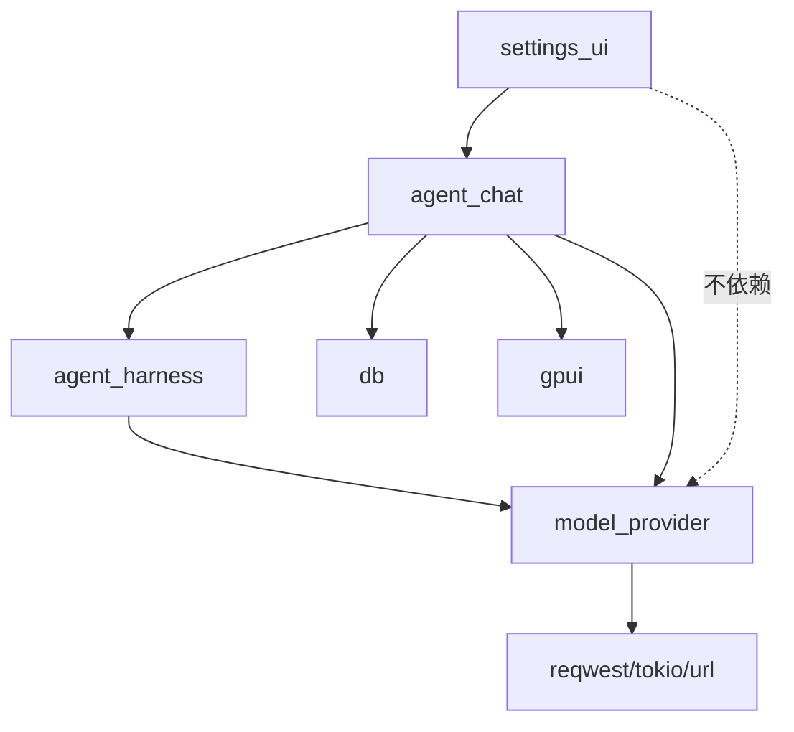

# P0-03 证据：接口落点与共享文件所有权

- 日期：2026-11-18
- 执行者：autocode（Claude Code）
- 依赖：P0-01、P0-02 完成

## 新增 crate 与所有权

| crate | 路径 | 入口 | 集成者 | 允许依赖 |
|---|---|---|---|---|
| `model_provider` | `crates/model_provider/` | `src/model_provider.rs` | P1 负责人 | `anyhow`、`async-trait`、`chrono`、`futures`、`reqwest`（workspace）、`serde`、`serde_json`、`serde_yaml_ng`、`thiserror`、`tokio`、`tokio-util`、`tracing`、`url`、`uuid`、`zeroize`；**不**依赖 `gpui`、`db`、`agent_harness`、`settings_content` |

需要同步修改 workspace：

- `Cargo.toml` `workspace.members` 增加 `"crates/model_provider"`（第 45-140 行区段）。
- `Cargo.toml` `workspace.dependencies` 增加 `model_provider = { path = "crates/model_provider" }`（240-330 行区段）。

## 直接依赖 `model_provider` 的消费者

- `crates/agent_harness/Cargo.toml`：仅增加 `model_provider.workspace = true`；内部只使用 Provider 投影与启动准备 DTO，不能引入 `gpui`。
- `crates/agent_chat/Cargo.toml`：增加 `model_provider.workspace = true`；本 crate 持有 GPUI 凭据 broker 与设置集成。
- `crates/settings_ui/Cargo.toml`：不直接依赖 `model_provider`；通过 `agent_chat` 暴露的 render 工厂挂接设置页。

## 文件责任（新增）

全部为 "待实施"，本任务只锁定文件边界与集成者；不创建空文件以避免未使用符号。

| 路径 | 唯一责任 | 集成者 |
|---|---|---|
| `crates/model_provider/src/model_provider.rs` | crate 根：re-export、错误类型、`ProviderServices` builder | P1-01 |
| `crates/model_provider/src/types.rs` | Provider/Endpoint/Model/Key/Header、`ModelSelection`、`BackendTarget`、`AuthMode`、`RoutingMode`、`Secret`、`ProbeResult` | P1-01 |
| `crates/model_provider/src/service.rs` | `ProviderService`、`ProviderRepository`/`CredentialStore` trait 与组合实现 | P1-05 |
| `crates/model_provider/src/router.rs` | `ModelRouter`、`PreparedRouting`、按启动选 Key | P4-02 |
| `crates/model_provider/src/probe.rs` | 模型发现与最小检测 | P4-03 |
| `crates/model_provider/src/gateway.rs` | 本地 Gateway 监听、租约、逐请求选 Key | P4-05 |
| `crates/model_provider/src/gateway/forward.rs` | HTTP 转发与背压 | P4-05 |
| `crates/model_provider/src/url.rs` | URL 规范化与来源校验 | P4-01 |
| `crates/agent_harness/src/pi.rs` | Pi RPC 适配 | P3-02 |
| `crates/agent_harness/src/omp.rs` | OMP rpc-ui 适配 | P3-03 |
| `crates/agent_harness/src/dsh.rs` | DSH ACP 适配 | P3-04（阻塞于本机 DSH 安装） |
| `crates/agent_harness/src/agent_rpc.rs` | 请求/响应关联，供 Pi/OMP/DSH 共享 | P3-01 |
| `crates/agent_harness/src/framing.rs` | JSONL 有界读 + OMP v2 分片重组 | P3-01 |
| `crates/agent_harness/src/pi_family.rs` | Pi/OMP 共享消息映射与 extension UI | P3-01 |
| `crates/agent_harness/src/provider_projection.rs` | Provider → extension/overlay/patch 生成 | P4-04 |
| `crates/agent_chat/src/provider_store.rs` | `ProviderDb` Domain 迁移与 Repository 实现 | P1-02 |
| `crates/agent_chat/src/provider_services.rs` | App 组合根、GPUI 凭据 broker、变更广播 | P1-03, P1-05 |
| `crates/agent_chat/src/provider_settings.rs` | 模型服务设置视图入口 | P5-02 |
| `crates/agent_chat/src/provider_settings/forms.rs` | 表单、草稿、迟到异步防护 | P5-02 |
| `crates/agent_chat/src/session_launch.rs` | 会话启动、generation、租约、凭据准备 | P2-02 |

Domain 命名约定（对应 `db::static_connection!`）：

- `ProviderDb`，依赖 `[]`（不依赖 WorkspaceDb，Provider 是全局数据）。
- `AgentPrefsDb` 可与 `ProviderDb` 合并为同一个 Domain，避免跨 Domain 事务。本设计默认合并到 `ProviderDb`。

## 现有文件必改清单（P0-03 锁定作者边界）

| 文件 | 修改性质 | 集成者 |
|---|---|---|
| `Cargo.toml`（workspace members + dependencies）| 新增一行 member + 一行 dep | P1-01（原子提交） |
| `crates/agent_chat/Cargo.toml` | 新增 `model_provider.workspace = true` 及后续需要的 `db` 使用 | P1-02 |
| `crates/agent_harness/Cargo.toml` | 新增 `model_provider.workspace = true` | P2-01 |
| `crates/agent_chat/src/agent_chat.rs` | `AgentKind` 扩展到 6 项、新增三个 Action、`ALL`、`label`、`has_plan_usage` | P5-01 |
| `crates/agent_chat/src/agent_panel.rs` | 新增 3 个 action 注册、`new_chat_action`、图标/品牌色、Pi/OMP/DSH 入口 | P5-01 |
| `crates/agent_chat/src/agent_chat_settings.rs` | 显示开关、默认权限、`AgentChatAgent` 映射增加三项 | P5-01 |
| `crates/agent_chat/src/chat_view/completion.rs` | `/new` 分发使用 `new_chat_action(kind)` | P5-01 |
| `crates/agent_chat/src/commit_message.rs` | 分支扩展（允许 Pi/OMP/DSH 作为 commit 消息 Agent） | P2-05 |
| `crates/agent_chat/src/model_picker.rs` | 显示 Provider/Model、brand、默认权限 | P5-03 |
| `crates/agent_chat/src/session.rs` | `harness_id`/`new_harness` 扩展、`RunSettings.model → ModelSelection`、启动 generation、迟到事件保护 | P1-06 + P2-02 原子集成 |
| `crates/agent_harness/src/agent_harness.rs` | `HarnessError::AgentMissing` 文案、`Harness::run` 签名调整 | P2-01 |
| `crates/agent_harness/src/proto.rs` | `HarnessId` 扩展到 6 值；`RunRequest.model` 迁移到结构化身份；`PermissionMode::choices` 分支 | P2-01（**一次 PR 内迁移所有调用者**） |
| `crates/agent_harness/src/view.rs` | 权限标签/描述分支 | P2-01 |
| `crates/agent_harness/src/accounts.rs` | 账号激活分支（Pi/OMP/DSH 无 OAuth） | P2-01 |
| 现有 `claude.rs`/`codex.rs`/`opencode.rs` | 使用新 `Harness::run` 签名；测试 `tests/claude.rs`、`codex.rs`、`opencode.rs` 中 15+ 处 `RunRequest { model: Some(..) }` 一次迁移 | P2-01 |
| `crates/settings_content/src/settings_content.rs` | `AgentChatAgent`/`AgentChatAgentsContent`/`AgentChatDefaultPermissionContent` 增加 Pi/OMP/DSH 变体；新增三个 `*PermissionDefault` 枚举 | P5-01 |
| `crates/settings_ui/src/settings_ui.rs` | 注册 3 个新 `*PermissionDefault` 下拉 + `AgentChatAgent` 新变体渲染 | P5-01 |
| `crates/settings_ui/src/page_data.rs` | `agent_chat_page` 显示新开关、增加新页面 `provider_services_page` | P5-02 |
| `assets/locales/zh-CN/actions/agent_chat.json` | 新增 `NewPiChat`/`NewOmpChat`/`NewDshChat` 文案 | P5-01 |
| `assets/locales/zh-CN/strings/agent_harness.json` | 新未安装/协议错误文案 | P2-01 |
| `assets/settings/default.json` | `agents` 显示开关增加 `pi`/`omp`/`dsh` 字段 | P5-01 |

**共享文件集成规则**：下列文件在一次 PR 内一致修改，禁止分多 PR 留下缺失分支：

- `AgentKind` 定义（`agent_chat.rs`）与其所有 `match self` / `AgentKind::ALL` 用点（通过编译错误收齐）。
- `HarnessId`（`proto.rs`）与其所有 `match` 用点（通过 `PermissionMode::choices`、`view.rs`、`accounts.rs` 等）。
- `AgentChatAgent`/`AgentChatAgentsContent`/`AgentChatDefaultPermissionContent`（`settings_content.rs`）与 `agent_chat_settings.rs` 中的映射。
- `RunRequest.model` 结构化迁移：`session.rs::start_run`、`commit_message.rs::run_once`、三个 Harness、它们的测试。

## 依赖方向复核

`agent_harness → model_provider`：仅依赖 `types`、`provider_projection` 所需的 DTO；**不**调用 `service`/`router`/`gateway`（网络和存储由 `agent_chat` 组合根驱动，启动时以 `LaunchContext` 下发）。

`settings_ui → agent_chat`：通过 `agent_chat` 的公共函数拿设置页渲染器；避免循环。

## 阻塞和决策

- **DSH 未安装**（P0-02）：`agent_harness/src/dsh.rs` 可按参考实现预先编码，但 P3-04/P3-06 的真实验证阻塞于 DSH 安装；验收矩阵需保留"未验证"状态，不写虚假证据。
- **OMP 实际 18.22.1 比参考包 18.14.2 新**：分片协议是否仍为 v2 在实施 P3-03 时须用隔离 profile 采样决定；若 OMP 已去掉 chunk，`framing.rs::Chunks` 调用保持向后兼容但不发错报警，再按证据调整。
- **模型发现需要 `--offline` 之外的联网**：`cargo check -p db` 当前触发 Git 依赖 `zed-industries/async-process.git` 下载；首次构建已在后台运行（bg_3），结果在到达时作为 P0-01 的完成证据。
- **本文件锁定接口边界后**：下游任务开始时读取本文件，不另自行划分文件。

## 完成条件复核

- 无循环依赖：✅（见上图）。
- 公共类型归属唯一：✅（Provider/Secret/ModelSelection 归 `model_provider::types`；AgentKind 归 `agent_chat`；HarnessId 归 `agent_harness::proto`；AgentChatAgent/Enum 归 `settings_content`）。
- 签名迁移范围明确：✅（P2-01 一次 PR 内完成 `Harness::run` 与所有调用者）。
- 协议差异决策：
  - OMP 版本偏新：实施期以真实 CLI 行为为准；
  - DSH 缺失：标注为阻塞不虚报；
  - Pi 协议参考包版本一致，可直接按设计 §9.2 实施。
